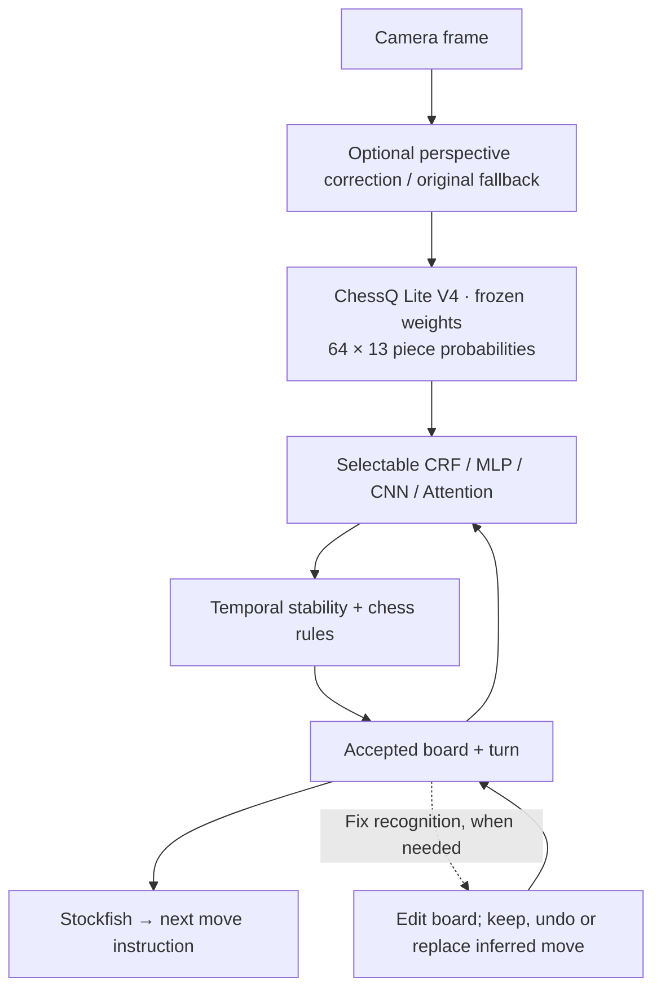

# Camera Chess — Play Stockfish on a real chessboard

**V1 · Apple Silicon macOS** · English | [简体中文](README.zh-CN.md) | [Русский](README.ru.md)

**A physical chessboard. A camera. A computer opponent that speaks its moves.**

Camera Chess is a camera-based chess app that lets you play **Stockfish on a physical chessboard**. **ChessQ Lite V4** recognizes the pieces locally on your Apple Silicon Mac, and a **selectable postprocessor trained for this project** combines its probabilities with the previous position. The digital board follows your moves, and the computer speaks its reply. Use an ordinary board and a camera—no electronic chessboard or piece sensors required.

[2026-10-11 · MP4 · 73 s](docs/media/progress-2026-10-11.mp4) · Earlier demos: [Screen recording · 55 sec](docs/media/demo-v1.mp4) · [Phone demo · portrait · 29 sec](docs/media/demo-v1-portrait.mp4) · [GIF preview](docs/media/demo-v1.gif)

The demo videos are silent; the app itself provides spoken moves.

## October 11 milestone: recognition, endgames and promotion

**Significant recognition accuracy improvement in our latest hands-on session**, with model enhancements including **CRF and Attention postprocessing**, temporal checks and chess-rule validation. Eight postprocessors are available; the default is the two-layer changed-square MLP. This describes the observed improvement in play, not a measured statistical gain attributable to any one model.

- **Image preprocessing:** automatic board localization, tracking and perspective correction reshape camera frames into a normalized board input. Settings shows the original camera image beside the corrected model input; unsuitable frames fall back to the original. [How perspective correction works](docs/perspective-experiment.md).
- **Endgame setup is working well:** enter **Endgame**, scan through the countdown, confirm the position and side to move, and start playing.
- **Pawn promotion is implemented and demonstrated on a physical board:** choose the promoted piece, confirm, and continue playing. The recording shows queen promotion while keeping the physical pawn as a substitute, followed by a move with that substitute. Queen, rook, bishop and knight choices, plus physical piece replacement, are supported; this recording does not exercise every option. [Implementation details](docs/promotion-physical-tracking.md).
- **Recovery:** batch recognition corrections, before/after comparisons, saved-game recovery and voice guidance remain available.

The existing 176-photo evaluation uses one constructed predecessor per image: **72.73% exact boards** for the two-layer MLP versus **71.02% for v1 CRF**. That incremental difference is modest and not statistically established; neither this demo nor that evaluation quantifies continuous-video accuracy or isolates the effect of perspective correction. [Accuracy and timing details](docs/crf-real-photo-synthetic-previous-evaluation.md#neural-postprocessor-comparison--2026-10-11).

### 1. Endgame → countdown → ready to play


Source: **00:00.8–00:01.8 + 00:07.8–00:21.8**. About one second on the home screen; the color-selection pause is cut. The countdown and confirmation play at original speed. This is an editing choice, not a one-second recognition claim.

### 2. Move the pawn and confirm promotion


Source: **00:21.8–00:37.0**, original speed. Advance the pawn, choose Queen and confirm **Keep pawn**.

### 3. Continue moving after promotion


Source: **00:37.0–00:47.5**, original speed. Follow the computer's move, then move the promoted pawn substitute as a queen. The digital board updates and the engine supplies its next reply.

[Full recording · 73 seconds · MP4](docs/media/progress-2026-10-11.mp4) · [Clip timestamps and export details](docs/media/README.md#october-11-2026-progress-demo). The GIFs stop before the later wait; the full video retains it. Exports are silent.

## Why it feels good

- **Real-board play:** ChessQ Lite V4 reads the camera image; the selected postprocessor, temporal checks and chess rules help resolve uncertain piece labels using the previous position.
- **A capable opponent:** Stockfish supplies legal moves with four difficulty levels, clear board arrows, and English voice guidance. Sound starts enabled.
- **Fast feedback:** live camera, board updates, move confirmation and recovery cues keep the physical and digital boards connected.
- **Simple controls:** click the floating ♞ to open the game, use **Back to Home** to leave a session, and **Quit Application** to stop every background component.
- **Practical recovery:** save/load positions, resume a session, correct a misread square, or start from a custom endgame position.
- **Promotion without spare pieces:** choose queen, rook, bishop or knight, then keep the pawn as a substitute or replace it with the chosen piece. Review the displayed board and confirm; if the camera has not confirmed it, the button explicitly accepts your manual confirmation.
- **Local processing:** camera recognition and engine play run on your Mac; no cloud inference account is required.

## How recognition works



The postprocessor is trained separately; the image recognizer's weights stay unchanged. It scores candidate positions using the previous board and current piece probabilities. Stable readings continue automatically through the turn rules. During the computer's turn, only its instructed move can be accepted; while it is thinking, another move cannot be committed. Corrections reconcile the edited board with current and recent positions and discard engine replies based on a mistaken move.

The postprocessors and UI are still being tuned. Synthetic validation and offline still-photo evaluation with constructed previous states do not establish continuous camera-stream accuracy. See the [experiment log](docs/crf-experiment-log.md) and [real-photo evaluation report](docs/crf-real-photo-synthetic-previous-evaluation.md) for results and scope, and the [dataset build record](docs/crf-data.md) for sources and reproducible preparation. Downloaded datasets, camera frames, saved games, correction archives and run logs stay local and are excluded from Git; the repository includes code, documentation and the small trained postprocessor checkpoints.

## V1 performance

Measured on the development Apple Silicon Mac, across **426 recorded frames**, before the CRF integration:

| Measurement | Median | 95th percentile |
| --- | ---: | ---: |
| Per-frame recognition processing | **387 ms** | **449 ms** |
| Capture-to-recognition-result latency | **487 ms** | **577 ms** |

These are warm-running frame timings, not camera startup or complete move-to-speech latency. Stable-position confirmation adds deliberate settling time. Both retained reference-board images matched their expected positions exactly (**2/2**); this small smoke check is not a general accuracy benchmark. The demo shows working physical-board play, while lighting, camera angle and occlusion still affect recognition.

**Automated checks** cover recognition, game state and browser interactions. The October 11 recording adds a physical-board demonstration of promotion and substitute movement; broader camera testing remains ongoing.

## Try it

Requires **Apple Silicon macOS**, **Python 3.12**, **Xcode Command Line Tools**, and **Stockfish**. This is a source release; dependency downloads need internet access, while recognition and gameplay run locally afterward.

```bash
git clone https://github.com/AmethystineAlpaca/camera_chess.git
cd camera_chess
# Install prerequisites if needed: brew install python@3.12 stockfish
# Install Apple's tools if needed: xcode-select --install
./setup.sh
./start.sh
```

Click the floating chess piece, select **Start a New Game**, allow camera access, and keep all 64 squares visible. The computer plays the color nearest the camera. Move its pieces when instructed, then clear your hands for confirmation. Settings controls difficulty, speaking voice and **Recognition Model**: ChessQ Lite V4 plus the selected postprocessor. The eight choices switch only the postprocessing layer, apply immediately and persist locally.

**Resume** keeps an in-memory game while the service runs; named **Save / Load** positions survive restarts and retain the saved player colors without checking board direction again. **Endgame** first asks which color you play, then scans the position and lets you confirm who moves next. Closing the last browser page stops the camera; quitting through the home screen or floating × closes the camera, recognition worker, engine and service.

**Promotion:** choose queen, rook, bishop or knight, then either keep the pawn as a substitute or replace it with the chosen piece. The digital board marks substitutes with **P**. If the camera has not confirmed the position, check the entire board before confirming manually; use **Fix recognition** for mistakes. Queen promotion with a pawn substitute and subsequent movement are demonstrated above; broader testing of the other choices is ongoing.

## Local improvement logs

Settings → **Log Data for potential improvements** controls local evidence recording (enabled by default). Images, probabilities and game decisions stay in `validation/improvement-logs/`, which is excluded from Git. **Open Log Folder** opens the local archive; turning collection off stops new archival writes without deleting earlier recordings. Nothing is uploaded automatically. [Storage, opt-out and review details](docs/local-improvement-data.md).

## Fix recognition

If the displayed position is wrong, open **Fix recognition**, choose the actual pieces (or Empty), and apply the changes together. Play waits while you edit. The app can keep a correctly recorded move, undo a false detection, or replace it with the actual move; you do not need to classify the error. You can undo edits before applying them and view the locally saved camera image, original reading and corrected board afterward.

## To do

- [ ] Polish onboarding, camera setup, sound feedback and permission/error messages.
- [x] Demonstrate endgame setup, queen promotion and subsequent pawn-substitute movement on a physical board.
- [ ] Extend physical-board testing to underpromotion, piece replacement, captures and recovery.
- [ ] Improve recognition accuracy and evaluate it across boards, lighting and camera angles.
- [ ] Reduce settling time and measure full move-to-feedback latency.
- [ ] Package a signed, notarized Mac release with simpler installation.

## Common questions

**Is this an electronic chessboard alternative?** It uses computer vision with an ordinary physical board. You move both your pieces and Stockfish's pieces by hand; this is not a robotic board.

**Does it need cloud AI or a subscription?** No cloud inference account is required. Setup downloads the dependencies and model; board recognition and engine play then run locally.

**Which recognition model does it use?** [ChessQ Lite](https://huggingface.co/joelseytre/chessq-lite), the ViT-S/14 V4 FP16 checkpoint (`cq-vit-s-644-v4-seed2-safetensors-fp16-r2`), followed by a selectable CRF, MLP, CNN or Attention postprocessor. The default is the two-layer changed-square MLP. ChessQ supplies image probabilities, the postprocessor uses the previous position to interpret them, and Stockfish chooses the moves.

**Does it support Windows, Linux, or online chess?** V1 targets Apple Silicon macOS and local play against Stockfish. It does not currently provide online game integration or a signed installer.

## Feedback & contributions

Tried it with your own board? [Share feedback or report a problem](https://github.com/AmethystineAlpaca/camera_chess/issues/new/choose). Board style, camera angle, lighting, Mac model, and a reproducible example help improve recognition. See [CONTRIBUTING.md](CONTRIBUTING.md) for development and testing.

## Development & credits

```bash
research/edgetam-env/bin/python -m unittest discover -s validation -p 'test_*.py'
for test in validation/test_ui_*.cjs; do node "$test" || exit; done
```

Application code lives in `validation/`; the browser UI is `validation/results/lite-live/index.html`. `start.sh` builds the Swift launcher. The historical `edgetam-env` name is the active Python runtime path.

Recognition: [ChessQueries / ChessQ Lite](https://github.com/JSeytre/chessqueries), **PolyForm Noncommercial 1.0.0**. Opponent: [Stockfish](https://stockfishchess.org/), **GPLv3**. Setup downloads the upstream recognition code and verifies the model checksum; third-party licenses apply separately.
