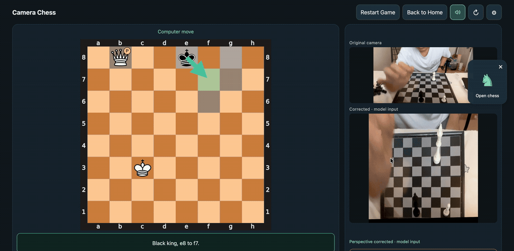
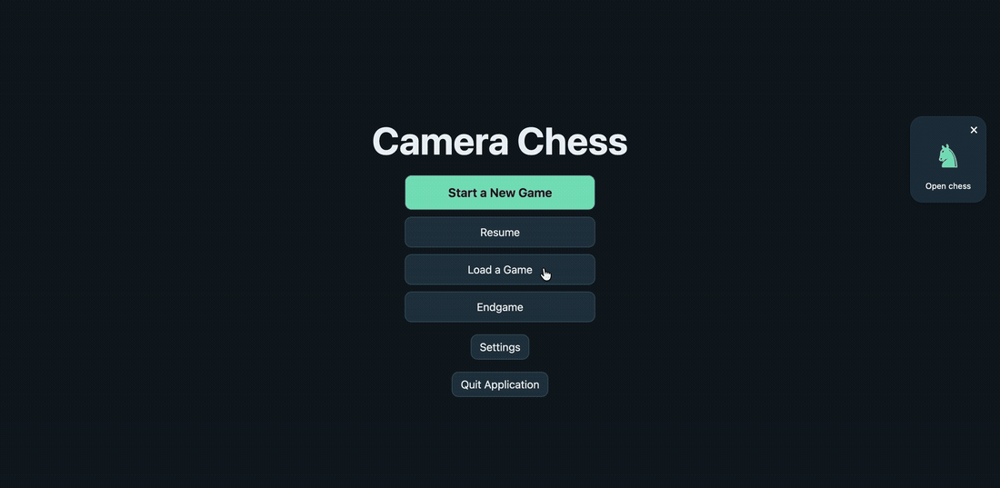
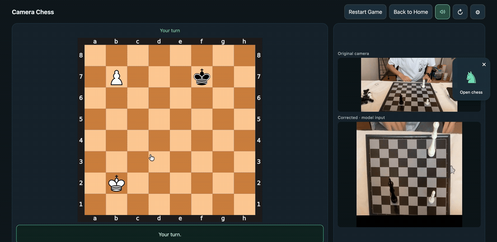
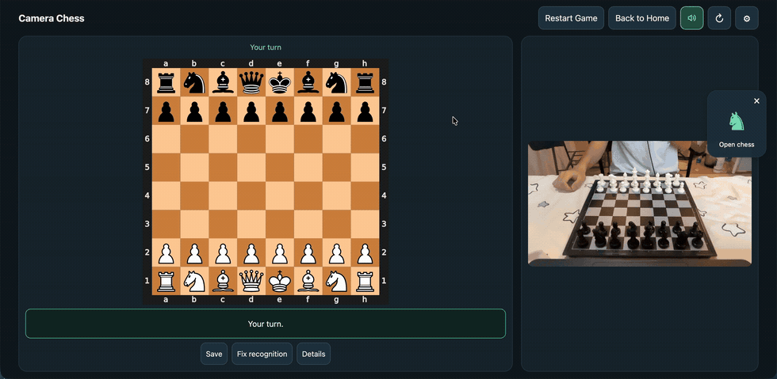
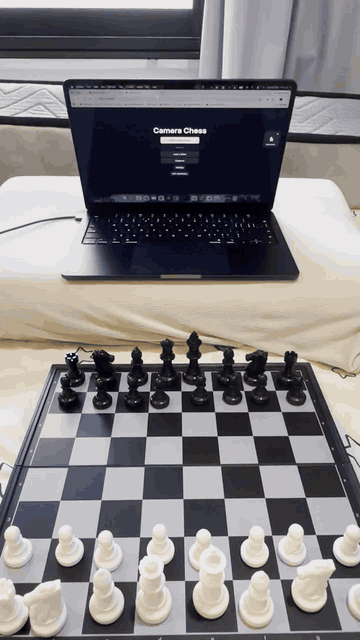

# Camera Chess — играйте в шахматы с ИИ локально на настоящей доске!

**Быстрое распознавание. Точное отслеживание доски. Голосовые подсказки. Всё на вашем Mac.**

**macOS на Apple Silicon** · [English](README.md) | [简体中文](README.zh-CN.md) | Русский

Обычная шахматная доска, камера и Mac превращаются в игру с локальным ИИ. Двигайте настоящие фигуры, следите за обновлением цифровой доски и слушайте ответ соперника. Шахматный ИИ работает на **Stockfish**.

**В основе — [ChessQ Lite V4](https://huggingface.co/joelseytre/chessq-lite) и [модели принятия решений, которые я обучил для Camera Chess](docs/crf-real-photo-synthetic-previous-evaluation.md#neural-postprocessor-comparison--2026-10-11).** ChessQ распознаёт фигуры, а дополнительный слой учитывает эти результаты, предыдущую позицию и шахматные правила. Вместе с **автоматической коррекцией перспективы** этот конвейер показал **значительное улучшение точности и надёжности распознавания в последнем сеансе на настоящей доске**.

- **Быстро и точно:** распознавание камерой, обученные для проекта CRF / нейронные модели и проверка последовательных кадров синхронизируют настоящую и цифровую доски.
- **Коррекция ракурса:** приложение находит и отслеживает доску, выравнивая изображение перед распознаванием.
- **Соперник с голосом:** четыре уровня сложности, стрелки ходов и голосовые подсказки на английском языке.
- **Играйте как удобно:** новая партия, заданный эндшпиль, выбор цвета при настройке эндшпиля, сохранение и загрузка позиций.
- **Превращение без запасных фигур:** выберите ферзя, ладью, слона или коня, при желании оставив физическую пешку вместо новой фигуры.
- **Локальная работа:** распознавание и движок работают на Mac. Электронная доска, датчики фигур и аккаунт облачного ИИ не нужны.



*Продолжайте играть после превращения: физическая пешка представляет ферзя.* Источник: **00:37.0–00:47.5**, исходная скорость.

[Полная демонстрация · 73 с · 1,23 МБ](docs/media/progress-2026-10-11.mp4) · [Установка](#установка) · [Распознавание и скорость](#распознавание-и-скорость)

## Расставьте эндшпиль и начинайте играть

Откройте **Endgame**, выберите свой цвет и дайте камере просканировать доску. Подтвердите позицию и очередь хода, затем играйте против ИИ.



Источник: **00:00.8–00:01.8 + 00:07.8–00:21.8**. Главный экран показан одну секунду; пауза выбора цвета вырезана. Сканирование и подтверждение идут с исходной скоростью.

## Превратите пешку и продолжайте партию

Выберите новую фигуру, оставьте пешку как заменитель или замените её физической фигурой и подтвердите. Значок **P** отмечает заменитель на цифровой доске; он ходит по правилам выбранной фигуры.



Источник: **00:21.8–00:37.0**, исходная скорость. В записи используется **Queen / Keep pawn** с ручным подтверждением. Проверьте показанную позицию перед подтверждением; при ошибке используйте **Fix recognition**.

Экспортированные демонстрации без звука; приложение озвучивает ходы. GIF заканчиваются до последующего ожидания в полной записи. [Таймкоды и экспорт](docs/media/README.md#october-11-2026-progress-demo) · [Предыдущая демонстрация](docs/media/demo-v1.mp4) · [Демонстрация, снятая на телефон](docs/media/demo-v1-portrait.mp4).

## Установка

Нужны **Mac с Apple Silicon**, **Python 3.12**, **Xcode Command Line Tools** и **Stockfish**. Сейчас доступна установка из исходного кода.

```bash
git clone https://github.com/AmethystineAlpaca/camera_chess.git
cd camera_chess
# При необходимости установите зависимости:
# brew install python@3.12 stockfish
# xcode-select --install
./setup.sh
./start.sh
```

Установка загружает зависимости и модель; затем распознавание и игра работают локально. Нажмите плавающую шахматную фигуру, разрешите доступ к камере и убедитесь, что видны все 64 поля. Переставляйте фигуры обеих сторон вручную, следуя стрелкам и голосовым подсказкам ИИ.

| Элемент | Возможности |
| --- | --- |
| **Start a New Game** | Новая партия из начальной позиции; ИИ играет цветом со стороны камеры. |
| **Endgame** | Сканирование заданной позиции, выбор своего цвета и очереди хода. |
| **Save / Load** | Именованные сохранения доступны после перезапуска и сохраняют цвета игроков. |
| **Resume** | Продолжение текущей партии, пока работает сервис. |
| **Settings** | Четыре уровня сложности, настройка голоса и выбор модели распознавания. |
| **Fix recognition** | Исправление нескольких полей, сравнение до/после и восстановление после ошибочного хода. |
| **Back to Home / Quit Application** | Выход из игры с остановкой камеры или закрытие всех фоновых компонентов. |

## Распознавание и скорость

**ChessQ Lite V4 + наши обученные модели + коррекция перспективы.** Модель изображения выдаёт вероятности фигур, а отдельно обученная постобработка учитывает предыдущую позицию. Восемь вариантов включают **CRF, MLP, CNN и Attention**; по умолчанию используется двухслойная changed-square MLP. Коррекция перспективы находит, отслеживает и выравнивает доску; если это невозможно, используется исходный кадр. Оба изображения видны рядом в настройках.

Последовательные кадры и шахматные правила определяют, когда принять позицию. Веса ChessQ Lite остаются неизменными, дополнительные модели обучены для проекта. [Оценка моделей](docs/crf-real-photo-synthetic-previous-evaluation.md) · [Коррекция перспективы](docs/perspective-experiment.md) · [Данные обучения](docs/crf-data.md).

**Быстрая обработка:** раннее измерение V1 на Mac разработчика по 426 кадрам после прогрева показало медиану **387 мс на обработку кадра** и **487 мс от захвата до результата**. Измерение сделано до интеграции CRF; запуск, подтверждение устойчивой позиции и полный ответ голосом требуют дополнительного времени.

**Точность:** последний сеанс на настоящей доске показал заметное практическое улучшение. В отдельной оценке 176 фотографий с построенными предыдущими позициями MLP распознал **72,73%** досок целиком, v1 CRF — **71,02%**. Небольшая разница между ними статистически не установлена; точность непрерывного видео и отдельный вклад коррекции перспективы пока не измерены. Освещение, ракурс и перекрытия по-прежнему влияют на результат. [Методика и результаты](docs/crf-real-photo-synthetic-previous-evaluation.md#neural-postprocessor-comparison--2026-10-11).

## Последние обновления · 11 октября 2026

- Восемь выбираемых моделей постобработки, включая обученные для проекта CRF и Attention.
- Автоматическая коррекция перспективы с просмотром оригинала и входа модели.
- Демонстрация эндшпиля, превращения и последующих ходов пешкой-заменителем на настоящей доске.
- Улучшения исправления распознавания, восстановления партий и голосовых подсказок.
- Отключаемая локальная запись данных для улучшений и доступ к папке журналов.

[Технический журнал](docs/crf-experiment-log.md) · [Превращение пешки](docs/promotion-physical-tracking.md). Проверки разных досок, превращений не в ферзя и замены физических фигур продолжаются.

## Ранние демонстрации

### Демонстрация игры (ранний интерфейс / Earlier UI)



[Запись экрана · 55 с](docs/media/demo-v1.mp4).

### Демонстрация, снятая на телефон (ранний интерфейс / Earlier UI)



[Видео, снятое на телефон · 29 с](docs/media/demo-v1-portrait.mp4).

## Данные остаются на вашем компьютере

Кадры камеры, сохранения, исправления и журналы улучшений остаются локальными и исключены из Git. **Log Data for potential improvements** включена по умолчанию; отключите её, чтобы прекратить новые записи. **Open Log Folder** открывает архив. Старые файлы сохраняются, автоматической отправки нет. [Хранение и настройки приватности](docs/local-improvement-data.md).

## Обратная связь и использованные проекты

[Сообщить о проблеме](https://github.com/AmethystineAlpaca/camera_chess/issues/new/choose) · [Участие в разработке](CONTRIBUTING.md)

V1 поддерживает локальную игру на Apple Silicon macOS. Подписанного установщика, других платформ и интеграции с онлайн-партиями пока нет. Интерфейс приложения остаётся на английском языке.

Распознавание использует [ChessQueries / ChessQ Lite](https://github.com/JSeytre/chessqueries), ViT-S/14 V4 FP16, с лицензией **PolyForm Noncommercial 1.0.0**. Шахматный ИИ использует [Stockfish](https://stockfishchess.org/) с лицензией **GPLv3**. Лицензии сторонних компонентов применяются отдельно.
