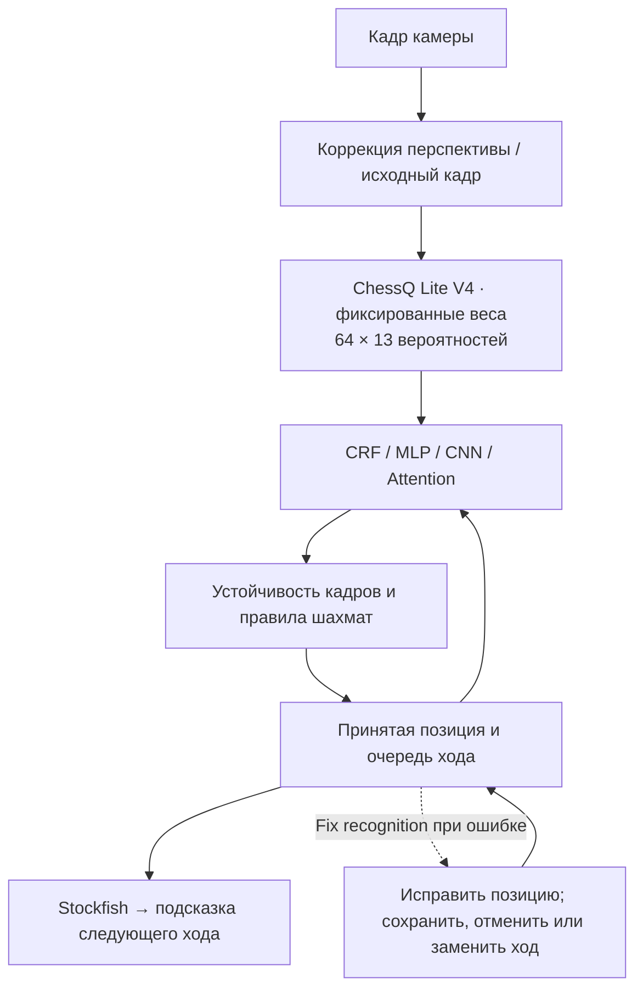

# Camera Chess — играйте в шахматы с ИИ на настоящей доске

**V1 · macOS на Apple Silicon** · [English](README.md) | [简体中文](README.zh-CN.md) | Русский

Обычная шахматная доска, камера и Mac: двигайте настоящие фигуры и играйте против компьютера. Camera Chess использует **ChessQ Lite V4** и **выбираемую модель постобработки, отдельно обученную для проекта**, которая учитывает предыдущую позицию. Приложение обновляет цифровую доску и озвучивает ответ, рассчитанный **Stockfish**. Фигуры за обе стороны нужно переставлять вручную. Электронная доска и датчики в фигурах не нужны.

[2026-10-11 · MP4 · 73 s](docs/media/progress-2026-10-11.mp4) · Ранние записи: [Запись экрана · 55 с](docs/media/demo-v1.mp4) · [Видео с телефона · 29 с](docs/media/demo-v1-portrait.mp4) · [GIF](docs/media/demo-v1.gif)

Демонстрационные видео не содержат звука. В самом приложении есть голосовые подсказки на английском языке. Эта страница переводит описание проекта, а не интерфейс приложения.

## Прогресс 11 октября: распознавание, эндшпиль и превращение

**В последней игре на настоящей доске точность распознавания заметно улучшилась.** Конвейер использует ChessQ Lite V4, постобработку **CRF / Attention**, проверку последовательных кадров и шахматных правил. Доступны восемь моделей постобработки; по умолчанию выбрана двухслойная changed-square MLP. Это наблюдение из практического сеанса, а не статистически подтверждённый эффект отдельной модели.

- **Предобработка изображения:** поиск и отслеживание доски, коррекция перспективы и нормализация входного изображения. В настройках исходный кадр показан рядом со входом модели; при неудачной коррекции используется оригинал. [Описание алгоритма](docs/perspective-experiment.md).
- **Эндшпиль:** вход через **Endgame**, сканирование с обратным отсчётом, подтверждение позиции и очереди хода, затем игра.
- **Превращение реализовано и показано на настоящей доске:** в записи пешка превращается в ферзя и остаётся физическим заменителем, после чего продолжает ходить как ферзь. Поддерживаются также ладья, слон, конь и замена физической фигуры; запись не охватывает все варианты. [Подробности](docs/promotion-physical-tracking.md).
- Сохраняются пакетное исправление распознавания, сравнение до/после, восстановление партий и голосовые подсказки.

На 176 фотографиях с одной построенной предыдущей позицией двухслойный MLP дал **72,73%** полностью верных досок против **71,02%** у v1 CRF. Этот небольшой прирост статистически не установлен. Точность непрерывного видео и отдельный вклад коррекции перспективы пока не измерены. [Результаты и время обработки](docs/crf-real-photo-synthetic-previous-evaluation.md#neural-postprocessor-comparison--2026-10-11).

### 1. Эндшпиль: вход, обратный отсчёт и начало игры


Источник: **00:00.8–00:01.8 + 00:07.8–00:21.8**. Главный экран показан около секунды; пауза выбора цвета вырезана. Обратный отсчёт и подтверждение идут с исходной скоростью. Это монтаж, а не распознавание за одну секунду.

### 2. Ход пешкой и подтверждение превращения


Источник: **00:21.8–00:37.0**, исходная скорость. Ход пешкой, выбор Queen и подтверждение **Keep pawn**.

### 3. Ходы после превращения


Источник: **00:37.0–00:47.5**, исходная скорость. После хода компьютера пешка-заменитель ходит как ферзь, цифровая доска обновляется и появляется следующий ответ движка.

[Полная запись · 73 с · MP4](docs/media/progress-2026-10-11.mp4) · [Таймкоды и экспорт](docs/media/README.md#october-11-2026-progress-demo). GIF заканчиваются до последующего ожидания; полная запись его сохраняет. Экспорт без звука.

## Возможности

- Игра на настоящей доске с четырьмя уровнями сложности и стрелками ходов на экране.
- Локальное распознавание: проверка уверенности модели и устойчивости позиции в последовательных кадрах.
- Сохранение и загрузка позиций, настройка эндшпиля и ручное исправление ошибок распознавания.
- Превращение пешки в ферзя, ладью, слона или коня: можно оставить пешку вместо новой фигуры или заменить её, затем проверить доску и подтвердить. Если камера ещё не подтвердила позицию, кнопка принимает ручное подтверждение. Значок **P** и список полей показывают пешки-заменители; их роли сохраняются при ходах, взятиях, отмене ходов и загрузке партии.
- Плавающая кнопка с шахматной фигурой для запуска игры и завершения работы приложения.
- Распознавание и шахматный движок работают на Mac; аккаунт облачного ИИ не требуется.

## Как это работает



Модель постобработки обучается отдельно, без изменения весов ChessQ Lite V4. Она оценивает возможные позиции по предыдущей доске и текущим вероятностям. Игра продолжается автоматически после проверки устойчивости и очереди хода. Пока компьютер думает, новый ход не фиксируется; после подсказки принимается только указанный ход. Исправления сопоставляются с текущей и недавними позициями, а ответы движка для ошибочной позиции отбрасываются.

Модели постобработки и интерфейс ещё настраиваются. Проверка на синтетических данных и офлайн-оценка отдельных фотографий с построенными предыдущими позициями не показывают точность непрерывной работы с камерой. Результаты и ограничения описаны в [журнале эксперимента](docs/crf-experiment-log.md) и [отчёте по фотографиям](docs/crf-real-photo-synthetic-previous-evaluation.md); источники и подготовка данных — в [записи о датасете](docs/crf-data.md). Датасеты, кадры камеры, сохранённые партии, архивы исправлений и журналы запусков остаются локальными и исключены из Git. В репозиторий входят код, документация и небольшие файлы весов моделей постобработки.

## Установка

Нужны **Mac с Apple Silicon**, **Python 3.12**, **Xcode Command Line Tools** и **Stockfish**. Это ранняя версия с установкой из исходного кода; подписанного установщика пока нет.

```bash
git clone https://github.com/AmethystineAlpaca/camera_chess.git
cd camera_chess
# При необходимости установите зависимости:
# brew install python@3.12 stockfish
# xcode-select --install
./setup.sh
./start.sh
```

При первом запуске установки нужен интернет для загрузки зависимостей и модели. Затем распознавание и игра работают локально.

Нажмите плавающую шахматную фигуру, выберите **Start a New Game**, разрешите доступ к камере и убедитесь, что видны все 64 поля. Компьютер играет за сторону, расположенную ближе к камере. Переставляйте его фигуры по подсказке, затем убирайте руки и ждите подтверждения позиции.

**Resume** продолжает партию, пока работает сервис. Именованные позиции **Save / Load** сохраняются между запусками. **Endgame** позволяет задать позицию, цвет игрока и очередь хода. Настройки управляют сложностью и голосом.

## Локальные журналы

Настройка **Log Data for potential improvements** управляет локальной записью данных и включена по умолчанию. Изображения, вероятности и решения хранятся в `validation/improvement-logs/`; каталог исключён из Git. **Open Log Folder** открывает архив. Отключение прекращает новые записи, сохраняя старые; автоматической отправки нет. [Хранение и просмотр](docs/local-improvement-data.md).

## Ограничения и измерения

Свет, угол камеры и перекрытые рукой фигуры могут мешать распознаванию. V1 предназначена для локальной игры на Apple Silicon macOS; интеграции с онлайн-партиями пока нет.

До добавления CRF на компьютере разработчика измерены 426 кадров после прогрева:

| Измерение | Медиана | 95-й процентиль |
| --- | ---: | ---: |
| Обработка кадра моделью | 387 мс | 449 мс |
| От захвата кадра до результата распознавания | 487 мс | 577 мс |

Это не полная задержка от хода до голосового ответа: подтверждение устойчивой позиции занимает дополнительное время. Две контрольные фотографии распознаны верно (2/2), но такой небольшой тест не показывает общую точность на разных досках.

## Обратная связь и использованные проекты

[Репозиторий](https://github.com/AmethystineAlpaca/camera_chess) · [Сообщить о проблеме](https://github.com/AmethystineAlpaca/camera_chess/issues/new/choose) · [Участие в разработке](CONTRIBUTING.md)

При описании проблемы полезны модель Mac, вид доски, расположение камеры и освещение.

Распознавание основано на готовой модели [ChessQueries](https://github.com/JSeytre/chessqueries) / [ChessQ Lite](https://huggingface.co/joelseytre/chessq-lite), ViT-S/14 V4 FP16, с лицензией **PolyForm Noncommercial 1.0.0**. Ходы выбирает [Stockfish](https://stockfishchess.org/) с лицензией **GPLv3**. Лицензии сторонних компонентов применяются отдельно.
