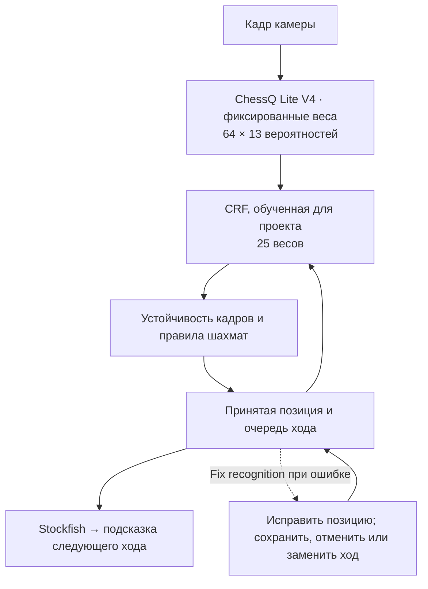

# Camera Chess — играйте в шахматы с ИИ на настоящей доске

**V1 · macOS на Apple Silicon** · [English](README.md) | [简体中文](README.zh-CN.md) | Русский

Обычная шахматная доска, камера и Mac: двигайте настоящие фигуры и играйте против компьютера. Camera Chess использует **ChessQ Lite V4** и **небольшую CRF-модель, отдельно обученную для проекта**, которая учитывает предыдущую позицию. Приложение обновляет цифровую доску и озвучивает ответ, рассчитанный **Stockfish**. Фигуры за обе стороны нужно переставлять вручную. Электронная доска и датчики в фигурах не нужны.


[Запись экрана · 55 с](docs/media/demo-v1.mp4) · [Видео с телефона · 29 с](docs/media/demo-v1-portrait.mp4) · [GIF](docs/media/demo-v1.gif)

Демонстрационные видео не содержат звука. В самом приложении есть голосовые подсказки на английском языке. Эта страница переводит описание проекта, а не интерфейс приложения.

## Возможности

- Игра на настоящей доске с четырьмя уровнями сложности и стрелками ходов на экране.
- Локальное распознавание: проверка уверенности модели и устойчивости позиции в последовательных кадрах.
- Сохранение и загрузка позиций, настройка эндшпиля и ручное исправление ошибок распознавания.
- Превращение пешки в ферзя, ладью, слона или коня: можно оставить пешку вместо новой фигуры или заменить её, затем подтвердить совпадение доски. Значок **P** и список полей показывают пешки-заменители; их роли сохраняются при ходах, взятиях, отмене ходов и загрузке партии.
- Плавающая кнопка с шахматной фигурой для запуска игры и завершения работы приложения.
- Распознавание и шахматный движок работают на Mac; аккаунт облачного ИИ не требуется.

## Последние изменения

- Добавлена обученная для проекта CRF-модель: устойчивые позиции принимаются автоматически, а **Fix recognition** позволяет исправить или отменить ошибочно распознанный ход. Первые отзывы об игре на настоящей доске положительные; нужны дополнительные испытания.
- Добавлен выбор фигуры при превращении пешки, включая использование пешки вместо запасной фигуры. **Функция реализована, но полное тестирование людьми на настоящей доске ещё не завершено.**
- Добавлено исправление нескольких ошибок распознавания за один раз со сравнением до и после.
- Улучшены настройка эндшпиля, восстановление сохранённых партий и голосовые подсказки.

Точность распознавания ещё требует улучшения, особенно при разных досках, освещении и углах камеры. **Известная проблема:** после превращения пешки компьютера в коня кнопка Confirm может оставаться недоступной. Нужно воспроизвести и исправить эту ошибку, затем продолжить испытания.

## Как это работает



CRF обучается отдельно, без изменения весов ChessQ Lite V4. Она оценивает возможные позиции по предыдущей доске и текущим вероятностям. Игра продолжается автоматически после проверки устойчивости и очереди хода. Пока компьютер думает, новый ход не фиксируется; после подсказки принимается только указанный ход. Исправления сопоставляются с текущей и недавними позициями, а ответы движка для ошибочной позиции отбрасываются.

Использованы **160 000 синтетических наблюдений для обучения**, **20 000 для валидации** и **20 000 отложены для тестирования**. Результаты на синтетических данных не доказывают точность на реальной камере. Подробности: [журнал эксперимента](docs/crf-experiment-log.md) и [подготовка данных](docs/crf-data.md). Датасеты, кадры камеры, сохранённые партии, архивы исправлений и журналы запусков остаются локальными и исключены из Git. В репозиторий входят код, документация и небольшой файл весов CRF.

## Установка

Нужны **Mac с Apple Silicon**, **Python 3.12**, **Xcode Command Line Tools** и **Stockfish**. Это ранняя версия с установкой из исходного кода; подписанного установщика пока нет.

```bash
git clone https://github.com/AmethystineAlpaca/camera_chess.git
cd camera_chess
# При необходимости установите зависимости:
# brew install python@3.12 stockfish
# xcode-select --install
./setup.sh
./start.sh
```

При первом запуске установки нужен интернет для загрузки зависимостей и модели. Затем распознавание и игра работают локально.

Нажмите плавающую шахматную фигуру, выберите **Start a New Game**, разрешите доступ к камере и убедитесь, что видны все 64 поля. Компьютер играет за сторону, расположенную ближе к камере. Переставляйте его фигуры по подсказке, затем убирайте руки и ждите подтверждения позиции.

**Resume** продолжает партию, пока работает сервис. Именованные позиции **Save / Load** сохраняются между запусками. **Endgame** позволяет задать позицию, цвет игрока и очередь хода. Настройки управляют сложностью и голосом.

## Ограничения и измерения

Свет, угол камеры и перекрытые рукой фигуры могут мешать распознаванию. V1 предназначена для локальной игры на Apple Silicon macOS; интеграции с онлайн-партиями пока нет.

До добавления CRF на компьютере разработчика измерены 426 кадров после прогрева:

| Измерение | Медиана | 95-й процентиль |
| --- | ---: | ---: |
| Обработка кадра моделью | 387 мс | 449 мс |
| От захвата кадра до результата распознавания | 487 мс | 577 мс |

Это не полная задержка от хода до голосового ответа: подтверждение устойчивой позиции занимает дополнительное время. Две контрольные фотографии распознаны верно (2/2), но такой небольшой тест не показывает общую точность на разных досках.

## Обратная связь и использованные проекты

[Репозиторий](https://github.com/AmethystineAlpaca/camera_chess) · [Сообщить о проблеме](https://github.com/AmethystineAlpaca/camera_chess/issues/new/choose) · [Участие в разработке](CONTRIBUTING.md)

При описании проблемы полезны модель Mac, вид доски, расположение камеры и освещение.

Распознавание основано на готовой модели [ChessQueries](https://github.com/JSeytre/chessqueries) / [ChessQ Lite](https://huggingface.co/joelseytre/chessq-lite), ViT-S/14 V4 FP16, с лицензией **PolyForm Noncommercial 1.0.0**. Ходы выбирает [Stockfish](https://stockfishchess.org/) с лицензией **GPLv3**. Лицензии сторонних компонентов применяются отдельно.
