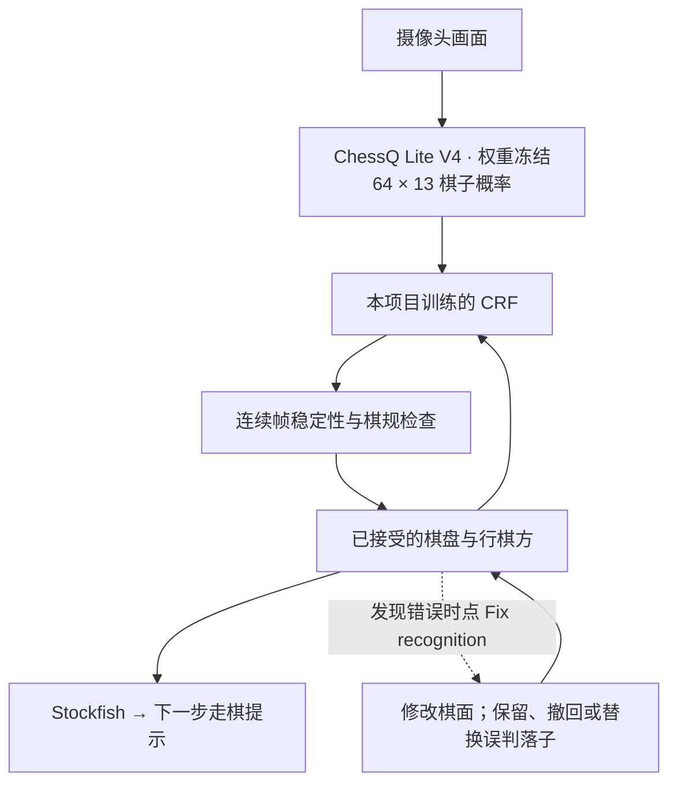

# Camera Chess — 用实体棋盘与 Stockfish 对弈

**V1 · Apple Silicon macOS** · [English](README.md) | 简体中文 | [Русский](README.ru.md)

普通国际象棋棋盘、摄像头和一台 Mac，就能与电脑下棋。Camera Chess 使用 **ChessQ Lite V4** 在本地识别棋子，再由**本项目单独训练的轻量 CRF** 结合上一局面修正识别结果，同步数字棋盘，并由 **Stockfish** 计算和语音播报下一步。无需电子棋盘或棋子传感器。


[屏幕录像 · 55 秒](docs/media/demo-v1.mp4) · [手机竖屏演示 · 29 秒](docs/media/demo-v1-portrait.mp4) · [GIF](docs/media/demo-v1.gif)

演示视频无声；应用本身支持英语语音播报。

## 主要功能

- **实体棋盘对弈：** ChessQ Lite V4 提供逐格概率，CRF 结合上一局面，再通过连续帧和棋规检查更新棋盘。
- **Stockfish 对手：** 四档难度、走棋箭头和英语语音提示。电脑的棋子由你手动移动。
- **本地 AI：** 棋盘识别和棋力引擎均在 Mac 上运行，无需云端推理账号。
- **保存与恢复：** 支持保存、载入棋局、纠正识别错误和设置残局。
- **无需备用棋子的升变：** 选择后、车、象或马，可以保留原兵作为替身，也可以换上对应实体棋子，等待棋盘识别一致后确认。
- **桌面入口：** 点击悬浮棋子进入游戏；返回主页停止摄像头；退出应用关闭后台组件。

## 最近更新

- 接入项目单独训练的 CRF，稳定识别后自动继续，发现错误时通过 **Fix recognition** 纠正或撤回误判。初步实体棋盘反馈较好，仍需更多实测。
- 新增兵升变选择，支持在没有备用棋子时保留原兵作为替身。**功能已实现，但尚未完成真人实体棋盘实测。**
- 支持一次纠正多个识别错误，并查看修改前后的对照。
- 改进残局设置、存档恢复和语音提示。

识别准确率仍有待提高，尤其是不同棋盘、光照和拍摄角度下的表现。**已知升变问题：** 电脑的兵升变成马后，Confirm 按钮可能无法点击，后续需要复现、修复并继续实测。

## 实现方式



CRF 单独训练，ChessQ Lite V4 的权重保持不变。CRF 根据上一局面和当前逐格概率对候选棋盘评分；识别稳定且符合行棋规则后自动继续。电脑思考期间不推进棋局，给出建议后只接受对应的落子。纠错时比较修正后的棋面与当前、之前的局面，并撤销基于误判生成的电脑建议。

CRF 模型和界面交互仍在持续调整。合成验证和使用合成前态的静态照片评测，都不能证明连续摄像头流程的准确率。结果与范围见[实验记录](docs/crf-experiment-log.md)和[真实照片评估报告](docs/crf-real-photo-synthetic-previous-evaluation.md)；数据来源与生成方法见[数据集构建记录](docs/crf-data.md)。下载数据、相机画面、存档、纠错档案和运行日志保留在本地，不纳入 Git；仓库包含代码、文档和小型 CRF 权重文件。

## 快速开始

需要 Apple Silicon Mac、Python 3.12、Xcode Command Line Tools 和 Stockfish。目前提供源码安装，尚无签名安装包。

```bash
git clone https://github.com/AmethystineAlpaca/camera_chess.git
cd camera_chess
# 如未安装依赖：brew install python@3.12 stockfish
# 如未安装 Apple 命令行工具：xcode-select --install
./setup.sh
./start.sh
```

首次安装需联网下载依赖和模型，之后识别和对弈在本地运行。点击悬浮棋子，选择 **Start a New Game**，允许摄像头访问，并让全部 64 格出现在画面中。靠近摄像头的一方由电脑执棋。按提示移动电脑棋子，再移开手等待确认。

**Resume** 恢复当前服务中的棋局；**Save / Load** 可跨重启保存棋局；**Endgame** 用于设置残局并确认执棋颜色和轮到哪方走。设置中可调整难度和语音。

**升变（实验功能）：** 可选择后、车、象或马，再保留原兵作为替身，或换上对应实体棋子。数字棋盘用 **P** 标记替身。功能已实现，但尚未完成真人实体棋盘实测。

## 纠正识别

识别正确时无需操作；有误时打开 **Fix recognition**，选择错误的格子并指定实际棋子或空格，可一次提交多处修改。编辑期间暂停自动推进。系统根据修正后的局面保留、撤回或替换误判的落子，无需手动选择错误类型。提交前支持撤销，提交后可查看保存在本地的相机图像、原始识别和修改后棋盘的对照。

## V1 实测表现

接入 CRF 之前，在开发用 Apple Silicon Mac 上测量的 426 帧记录：

| 指标 | 中位数 | P95 |
| --- | ---: | ---: |
| 单帧识别处理耗时 | 387 ms | 449 ms |
| 采集到识别结果的延迟 | 487 ms | 577 ms |

这是预热后的逐帧统计，不是启动耗时，也不是完整的走棋到语音响应延迟；稳定局面确认还需要等待。两张保留的参考棋盘图像均与预期位置一致（2/2），样本量不足以代表总体准确率。光照、拍摄角度和遮挡仍会影响识别。

当前应用已通过 166 项 Python 测试和 7 个前端自动化测试脚本。这些检查不代表真实场景的识别准确率，也不能替代升变功能的真人实测。

## 接下来

- 改善首次使用、摄像头设置、声音反馈及权限提示。
- 改善残局设置、行棋方确认和局面恢复。
- 提高识别准确率，扩充不同棋盘、光照和角度的评测。
- 完成升变功能的真人实测，覆盖非后升变和兵替身。
- 修复电脑兵升变成马后 Confirm 按钮无法点击的问题。
- 减少稳定确认等待，并测量完整交互延迟。
- 提供经过签名和公证的 Mac 安装包。

## 反馈与致谢

[项目主页](https://github.com/AmethystineAlpaca/camera_chess) · [反馈与问题](https://github.com/AmethystineAlpaca/camera_chess/issues/new/choose) · [参与开发](CONTRIBUTING.md)

棋盘识别来自 [ChessQueries](https://github.com/JSeytre/chessqueries) / [ChessQ Lite](https://huggingface.co/joelseytre/chessq-lite)，使用 ViT-S/14 V4 FP16 权重，遵循 PolyForm Noncommercial 1.0.0；棋力引擎为 [Stockfish](https://stockfishchess.org/)，遵循 GPLv3。第三方许可分别适用。
