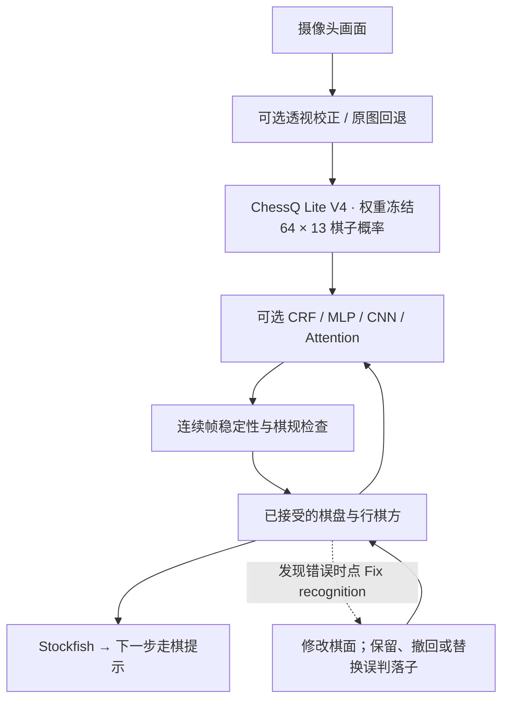

# Camera Chess — 用实体棋盘与 Stockfish 对弈

**V1 · Apple Silicon macOS** · [English](README.md) | 简体中文 | [Русский](README.ru.md)

普通国际象棋棋盘、摄像头和一台 Mac，就能与电脑下棋。Camera Chess 使用 **ChessQ Lite V4** 在本地识别棋子，再由**本项目单独训练的可选后处理模型** 结合上一局面修正识别结果，同步数字棋盘，并由 **Stockfish** 计算和语音播报下一步。无需电子棋盘或棋子传感器。

[2026-10-11 · MP4 · 73 s](docs/media/progress-2026-10-11.mp4) · 早期演示: [屏幕录像 · 55 秒](docs/media/demo-v1.mp4) · [手机竖屏演示 · 29 秒](docs/media/demo-v1-portrait.mp4) · [GIF](docs/media/demo-v1.gif)

演示视频无声；应用本身支持英语语音播报。

## 10 月 11 日进展：识别、残局与升变

**本次实机对弈中，识别准确率有明显提升。** 当前识别流程在 ChessQ Lite V4 之上加入 **CRF、Attention 等模型后处理增强**，结合连续帧和棋规检查。八种后处理模型可切换，默认使用两层 changed-square MLP。这里描述的是本次实机体验的进步，不是某个模型带来统计显著提升的结论。

- **图像预处理：** 自动定位、跟踪棋盘，并通过透视校正将摄像头画面转换为规范的棋盘输入。设置中并排展示原图和校正后的模型输入，不适合校正的帧回退到原图。[算法与实现](docs/perspective-experiment.md)。
- **残局流程已跑通，体验明显改善：** 从 **Endgame** 进入，倒计时扫描棋盘，确认局面与行棋方后即可开始。
- **升变已实现，并完成本次实体棋盘演示：** 选择升变棋子、确认后继续走棋。视频展示了保留实体兵作为后的替身，并继续按后的规则移动。后、车、象、马及更换实体棋子的方式均已支持，本视频未覆盖所有组合。[实现说明](docs/promotion-physical-tracking.md)。
- **纠错与恢复：** 支持批量纠错、修改前后对照、存档恢复和语音提示。

已有的 176 张照片评估中，每张使用一个构造的前态：两层 MLP 的整盘准确率为 **72.73%**，v1 CRF 为 **71.02%**。这一增量较小，统计上尚未确立；本次演示与静态评估都不是连续视频准确率测量，也未单独量化透视校正的收益。[准确率与耗时详情](docs/crf-real-photo-synthetic-previous-evaluation.md#neural-postprocessor-comparison--2026-10-11)。

### 1. 进入残局 → 倒计时 → 确认开局


原视频：**00:00.8–00:01.8 + 00:07.8–00:21.8**。首页保留约 1 秒，跳过选色停顿；扫描倒计时和确认过程保持原速。这是剪辑安排，不代表识别只需 1 秒。

### 2. 移动兵并完成升变


原视频：**00:21.8–00:37.0**，原速。推进兵，选择 Queen，再以 **Keep pawn** 方式确认升变。

### 3. 升变后继续移动


原视频：**00:37.0–00:47.5**，原速。执行电脑走棋后，按后的规则移动兵替身，数字棋盘同步并给出下一步应手。

[完整录像 · 73 秒 · MP4](docs/media/progress-2026-10-11.mp4) · [片段时间与导出说明](docs/media/README.md#october-11-2026-progress-demo)。GIF 在后段等待前结束，完整视频保留该段。导出文件无声。

## 主要功能

- **实体棋盘对弈：** ChessQ Lite V4 提供逐格概率，所选后处理模型结合上一局面，再通过连续帧和棋规检查更新棋盘。
- **Stockfish 对手：** 四档难度、走棋箭头和英语语音提示。电脑的棋子由你手动移动。
- **本地 AI：** 棋盘识别和棋力引擎均在 Mac 上运行，无需云端推理账号。
- **保存与恢复：** 支持保存、载入棋局、纠正识别错误和设置残局。
- **无需备用棋子的升变：** 选择后、车、象或马，可以保留原兵作为替身，也可以换上对应实体棋子，核对显示的棋盘后确认；相机尚未确认时，按钮明确采用人工确认。
- **桌面入口：** 点击悬浮棋子进入游戏；返回主页停止摄像头；退出应用关闭后台组件。

## 实现方式



后处理模型单独训练，ChessQ Lite V4 的权重保持不变。后处理模型根据上一局面和当前逐格概率对候选棋盘评分；识别稳定且符合行棋规则后自动继续。电脑思考期间不推进棋局，给出建议后只接受对应的落子。纠错时比较修正后的棋面与当前、之前的局面，并撤销基于误判生成的电脑建议。

后处理模型和界面交互仍在持续调整。合成验证和使用合成前态的静态照片评测，都不能证明连续摄像头流程的准确率。结果与范围见[实验记录](docs/crf-experiment-log.md)和[真实照片评估报告](docs/crf-real-photo-synthetic-previous-evaluation.md)；数据来源与生成方法见[数据集构建记录](docs/crf-data.md)。下载数据、相机画面、存档、纠错档案和运行日志保留在本地，不纳入 Git；仓库包含代码、文档和小型后处理模型权重文件。

## 快速开始

需要 Apple Silicon Mac、Python 3.12、Xcode Command Line Tools 和 Stockfish。目前提供源码安装，尚无签名安装包。

```bash
git clone https://github.com/AmethystineAlpaca/camera_chess.git
cd camera_chess
# 如未安装依赖：brew install python@3.12 stockfish
# 如未安装 Apple 命令行工具：xcode-select --install
./setup.sh
./start.sh
```

首次安装需联网下载依赖和模型，之后识别和对弈在本地运行。点击悬浮棋子，选择 **Start a New Game**，允许摄像头访问，并让全部 64 格出现在画面中。靠近摄像头的一方由电脑执棋。按提示移动电脑棋子，再移开手等待确认。

**Resume** 恢复当前服务中的棋局；**Save / Load** 可跨重启保存棋局；**Endgame** 用于设置残局并确认执棋颜色和轮到哪方走。设置中可调整难度、语音和 **Recognition Model**。完整识别模型为 ChessQ Lite V4 加上所选后处理模型；八个选项仅切换后处理层，即时生效并保存在本地，默认使用两层 changed-square MLP。

**升变：** 可选择后、车、象或马，再保留原兵作为替身，或换上对应实体棋子。数字棋盘用 **P** 标记替身。相机尚未确认时，请核对整盘后再人工确认，有误可用 **Fix recognition** 修正。上方实机演示已展示保留兵替身升后并继续移动；其余选项仍需扩展实测。

## 本地改进日志

设置中的 **Log Data for potential improvements** 控制本地证据记录，默认开启。图像、概率和棋局决策保存在 `validation/improvement-logs/`，该目录已加入 Git 忽略规则。**Open Log Folder** 可打开本地档案；关闭记录只停止新增归档，不删除已有数据。不会自动上传。[存储、关闭与审阅说明](docs/local-improvement-data.md)。

## 纠正识别

识别正确时无需操作；有误时打开 **Fix recognition**，选择错误的格子并指定实际棋子或空格，可一次提交多处修改。编辑期间暂停自动推进。系统根据修正后的局面保留、撤回或替换误判的落子，无需手动选择错误类型。提交前支持撤销，提交后可查看保存在本地的相机图像、原始识别和修改后棋盘的对照。

## V1 实测表现

接入 CRF 之前，在开发用 Apple Silicon Mac 上测量的 426 帧记录：

| 指标 | 中位数 | P95 |
| --- | ---: | ---: |
| 单帧识别处理耗时 | 387 ms | 449 ms |
| 采集到识别结果的延迟 | 487 ms | 577 ms |

这是预热后的逐帧统计，不是启动耗时，也不是完整的走棋到语音响应延迟；稳定局面确认还需要等待。两张保留的参考棋盘图像均与预期位置一致（2/2），样本量不足以代表总体准确率。光照、拍摄角度和遮挡仍会影响识别。

自动化检查覆盖识别、棋局状态和前端交互；10 月 11 日录屏补充了实体棋盘上的升变与替身移动演示。更广泛的摄像头实测仍在继续。

## 接下来

- 改善首次使用、摄像头设置、声音反馈及权限提示。
- 提高识别准确率，扩充不同棋盘、光照和角度的评测。
- 扩展升变实测，覆盖非后升变、更换实体棋子、吃子与局面恢复。
- 减少稳定确认等待，并测量完整交互延迟。
- 提供经过签名和公证的 Mac 安装包。

## 反馈与致谢

[项目主页](https://github.com/AmethystineAlpaca/camera_chess) · [反馈与问题](https://github.com/AmethystineAlpaca/camera_chess/issues/new/choose) · [参与开发](CONTRIBUTING.md)

棋盘识别来自 [ChessQueries](https://github.com/JSeytre/chessqueries) / [ChessQ Lite](https://huggingface.co/joelseytre/chessq-lite)，使用 ViT-S/14 V4 FP16 权重，遵循 PolyForm Noncommercial 1.0.0；棋力引擎为 [Stockfish](https://stockfishchess.org/)，遵循 GPLv3。第三方许可分别适用。
