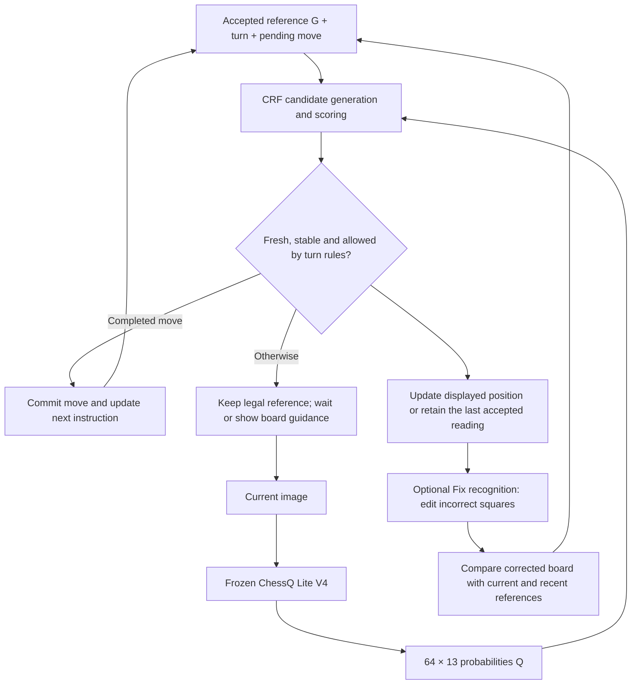

# Archived CRF Experiment Log — Evaluation Scope Issues / 旧评测存在适用范围问题

Archived on 2026-10-11 at the user's request. Active document: [crf-experiment-log.md](crf-experiment-log.md).

> **Not a real-video evaluation / 不能作为真实视频流效果结论。** The preserved log below contains synthetic-probability and static-photo diagnostics. Structured scoring was given an annotated, assumed-correct previous board for each observation; it did not evaluate continuous prediction feedback. The synthetic direct-argmax baseline was generated from artificial probabilities, not measured camera recognition. These results have limited offline diagnostic value and must not be presented as the real CRF-disabled application baseline, end-to-end camera accuracy, or deployment gains.
>
> The historical content and numerical results below are preserved in full for traceability, not endorsed as the active evaluation protocol. The active log has removed those result tables and conclusions pending real-video evaluation.

Original document SHA-256 before this archive header: `014d3fbbf05f370fc25313e82b661c6496e5d9df7416ba5367275d8910ec0bd0`.

---

# CRF Accuracy Improvement — Experiment Log

Last updated: 2026-10-11 · Branch: `accuracy-improvement`

**Status:** The 25-weight v1 remains integrated on `accuracy-improvement` for the user's local trial. The separately trained 250-weight v2 comparison is complete in E10 and did not improve on v1; its checkpoint is saved separately and is not used by the application. Stable recognized positions advance automatically; **Fix recognition** is the only recognition-review action. Corrections reconcile the current board with recent pre-move references, including undoing a false move and its engine reply. The earlier public-photo screening failure remains recorded in E06; the user subsequently authorized integration in E07. No branch merge or deployment-accuracy claim.

The design section below describes the current implementation. Dated entries preserve earlier decisions and measured results, including the initial stop after validation. Dataset provenance, formats, coverage counts, and reproduction commands live in the [dataset build record](crf-data.md). Bulk data and run artifacts under `data/crf/` are local and Git-ignored.

## Ongoing experiment — CRF postprocessing and capacity comparison

**Current stage, as of 2026-10-11:** E10 compares the preserved 25-weight v1 with a new 250-weight model using the same training/validation data and 12-epoch budget. Synthetic validation exact-board accuracy was 98.280% versus 97.975%; public-photo validation was 43/67 versus 42/67. Both held-out test sets remain unscored. The application still uses v1. Initial physical-board feedback on v1 was encouraging, with a reported disabled Confirm button after a computer pawn promotes to a knight. E07 records implementation and automated verification; E09 records that manual feedback and remaining work. E10 did not regenerate data or alter the application.

### Where the current data came from

| Data stream | Source | Current artifact and intended use |
| --- | --- | --- |
| Main synthetic dataset | Official Lichess standard-game PGNs: [January 2013](https://database.lichess.org/standard/lichess_db_standard_rated_2013-01.pgn.zst) and [February 2013](https://database.lichess.org/standard/lichess_db_standard_rated_2013-02.pgn.zst), CC0; first 6,000 games from each archive | `data/crf/synthetic-v1/`: 20,000 unique transitions, expanded into 200,000 observations for training/validation/testing |
| Auxiliary real photographs | [Felix Fabricius's Robot chess commentator dataset](https://huggingface.co/datasets/felixfabricius/robot-chess-commentator-squares), CC-BY-4.0; pinned revision `d71ba52761e497b18bbe5743efcbafb0d1f21091` | `data/crf/real/robot-v1/`: 371 source photos, yielding 176 retained legal transition examples with measured frozen-model probabilities |
| Local partial labels | This application's existing human correction archives, paired with the original image and model output | `data/crf/real/local-corrections/`: 26 frames with 27 explicitly labeled squares, for calibration only |

The **200,000 main observations are generated probability arrays, not generated images or measured model outputs**. Their board labels come from replayed PGNs and explicitly marked derived transitions. The public photographs and local corrections are separate auxiliary datasets and are not mixed into that count. Source checksums and acquisition metadata are recorded in the PGN source manifest (`data/crf/raw/sources.json`, local only) and photo source manifest (`data/crf/real/robot-v1/source.json`, local only).

### Operations completed

1. **Acquire and verify sources.** Downloaded both complete PGN archives and the pinned public board-image files; checked published SHA-256 hashes. Verified local image/output pairing before accepting correction labels.
2. **Replay and filter chess records.** Parsed 12,000 games with `python-chess`, rejected invalid/short records, and deduplicated games. Replayed 799,101 legal plies from 11,943 unique valid games; sampled ordinary transitions, retained special moves, and generated separately tagged legal promotion alternatives.
3. **Deduplicate and partition before probability augmentation.** Removed 14,779 duplicate transitions. Assigned source games to train/validation/test and excluded 4,658 transitions with placements shared across splits. All variants of a transition stay together.
4. **Select and supplement 20,000 transitions.** Retained 18,000 legal moves (16,022 recorded moves and 1,978 generated promotion alternatives), then generated 1,500 unchanged examples and 500 identity-preserving illegal relocations. Checked derived placements for split overlap too.
5. **Generate and validate observations.** Produced ten `64 × 13` probability variants per transition, keeping previous-state and target labels intact. Profiles cover clean observations, type/occupancy/color confusion, neighboring-square errors, confident mistakes, and regional uncertainty. Saved 40 shards: 160,000 train / 20,000 validation / 20,000 test observations, with metadata, seeds, checksums, and the exact generator snapshot.
6. **Prepare auxiliary real data.** Filtered public annotations, deduplicated transitions, removed cross-split and synthetic overlaps, normalized image orientation, and ran frozen ChessQ Lite inference on the 176 retained examples. For local corrections, retained only explicitly labeled squares and masked all other cells. These are still-photo/partial-label records, not verified continuous-video events.

### Current status

| Work item | Status | Evidence / remaining work |
| --- | --- | --- |
| Source acquisition, builders, and smoke run | Complete | Seven focused tests passed; 1,000-transition / 10,000-observation smoke build validated |
| Full synthetic dataset | Generated; structural validation passed | 200,000 samples / 12.8 million probability rows checked; zero duplicate inputs/transitions or cross-split games/placements in the validation report (`data/crf/synthetic-v1/validation.json`, local only) |
| Auxiliary real data and probability cache | Prepared; structural validation passed | 176 public examples and 27 local square labels; zero audited split/endpoint overlaps in the real-data report (`data/crf/real/validation.json`, local only) |
| Candidate generation and fixed-weight baseline | Implemented and evaluated | 100% target coverage over 18,000 train/validation transitions; 94.60% synthetic validation exact-board accuracy with fixed weights |
| CRF fitting and comparison | Complete; integration gate failed | 25 weights, 12 CPU epochs; 98.28% synthetic validation and 64.18% public-photo validation exact-board accuracy |
| Capacity comparison, v1-25 versus v2-250 | Complete; v2 did not improve over v1 | Same data/splits and 12 epochs; v2: 97.975% synthetic validation, 42/67 public photos; separate checkpoint and full epoch comparison in E10 |
| Application integration | Implemented for user-authorized trial | Stable automatic acceptance with one state-correction editor; current/previous-state reconciliation; see E07 |
| Branch merge | Not performed | Awaiting the user’s camera test |
| In-domain video calibration and final evaluation | Outstanding | 0 verified continuous-video events; target several hundred to 1,000 independent events |

**Interpretation:** Learning improves over fixed scoring, but the improvement does not yet deliver reliable real-image recognition. For v1, synthetic training and validation are both about 98.28%, while public-photo validation is 64.18%. E10's larger feature family did not improve these results under the matched training budget. This does not establish an optimal parameter count: feature design, optimization, regularization, and synthetic-to-real mismatch remain confounded. E04 records the original frozen-recognizer baseline; E06 and E10 record the two trained postprocessors and their limitations.

## Design — current revision

The original proposal introduced a frozen recognizer plus a small CRF postprocessor. E07 replaced mandatory per-observation confirmation with automatic play and optional state correction. The equations, flow and terminology below now reflect that revision; the earlier confirmation policy is retained only as a historical decision in the experiment entries.

### Objective and hypothesis

Improve board recognition accuracy and response time without changing ChessQ Lite V4's weights. A piece-type error in one image should not override the accepted previous board when the implied transition is implausible. A real illegal move should remain detectable rather than being forced into a legal move. The user corrects the recognized state through **Fix recognition**, without labeling the cause of an error.

The working hypothesis is that a small temporal postprocessor can correct some visual errors using piece identity, movement, and unchanged-square evidence. Whether it does so reliably on this camera and chess set remains to be tested.

### Model and state

Use a **single-step conditional log-linear model**, described here as a CRF postprocessor with its previous state fixed. Candidate scoring is how this model performs inference; it is not an additional neural model after the CRF. The implemented model has 25 shared weights trained independently from the frozen recognizer.

| Symbol | Meaning |
| --- | --- |
| `G` | Current accepted legal reference: 64 piece labels plus side to move, castling rights, and effective en passant information; retain game history separately |
| `Q` | Current image's `64 × 13` class probabilities from the frozen recognizer |
| `B` | Candidate current physical board, represented by 64 labels |
| `B*` | Ground-truth target during training, or the edited physical board when the user applies a correction |
| `C(G)` | Candidate boards reachable from `G` by supported operations |
| `m` | Pending computer move, if an instruction has been issued |

During live play, `G` can be provisionally accepted by the application rather than explicitly checked by the user. Not opening Fix recognition permits play to continue; it does not certify the board as human-labeled ground truth. In training v1, the previous state is correct by construction, so those validation scores do not measure recovery from an already mistaken live reference.

Class order is `. P N B R Q K p n b r q k`; square order is a8 through h8, then a7 through h7, down to a1 through h1. The 64-label vector alone is insufficient to determine all legal transitions.

### Transition and scoring equations

For this first experiment, one observation interval contains either no completed move, one completed legal move, or one supported physical mistake. Let `A(G)` contain those operations:

$$
\mathcal A(G)=\{\mathrm{unchanged}\}\cup\mathcal A_{\mathrm{legal}}(G)\cup\mathcal A_{\mathrm{mistake}}(G),
\qquad
\mathcal C(G)=\{T_{\mathrm{physical}}(G,a):a\in\mathcal A(G)\}.
$$

`T_physical` returns the resulting piece placement. Legal operations include captures, castling, en passant, and promotions. Supported mistakes preserve the moved piece's identity; v1 data cover a non-king piece relocated illegally to an empty square. An arbitrary pawn-to-bishop change away from promotion is not a supported transition. Multiple missed moves and intermediate hand/piece occlusions require rejection or resynchronization; v1 does not model them.

Score and normalize over candidates:

$$
s_\theta(G,Q,B)=\theta^\top f(G,Q,B),
\qquad
P_\theta(B\mid G,Q)=
\frac{\exp s_\theta(G,Q,B)}{\sum_{B'\in\mathcal C(G)}\exp s_\theta(G,Q,B')},
\qquad
\hat B=\underset{B\in\mathcal C(G)}{\arg\max}\;s_\theta(G,Q,B).
$$

Implemented features combine per-class visual fit, empty/white/black evidence, probability fit, argmax agreement, and operation flags. One visual-fit feature is:

$$
f_{\mathrm{visual}}(Q,B)=\sum_{i=1}^{64}\log\bigl(\max(Q_{i,B_i},\epsilon)\bigr).
$$

These classifier probabilities are features, not a claim that the recognizer supplies a generative HMM emission model. The previous state is fixed for each inference call, so training uses pairs of successive states rather than requiring a long-sequence network. A first-order Markov assumption alone would not eliminate sequence inference if previous states were uncertain; the current implementation uses explicit correction and rollback to repair an erroneous accepted reference.

Train only the postprocessor by conditional negative log-likelihood, with optional L2 regularization:

$$
\mathcal L(\theta)=-\frac1N\sum_{n=1}^{N}\log P_\theta(B_n^*\mid G_n,Q_n)+\lambda\lVert\theta\rVert_2^2.
$$

Every training target must be present in its candidate set; this was audited before fitting. A high relative probability does not establish that any candidate is correct. The live adapter therefore also checks absolute visual fit, occupancy evidence and temporal stability. E07 records the current heuristic thresholds; real-video calibration remains outstanding. Legal / unchanged / illegal-operation labels and uncertainty are internal model or controller information, not review categories for the user.

### Automatic acceptance and correction



For ordinary play, let `E` mean that the fresh-evidence and stability checks passed. The automatic update is:

$$
G_{\mathrm{next}}=
\begin{cases}
\operatorname{ApplyLegal}(G,a) & E\ \land\ \text{player turn and }\hat B=T_{\mathrm{physical}}(G,a),\\
\operatorname{ApplyLegal}(G,m) & E\ \land\ \text{computer turn, }m\text{ issued and }\hat B=T_{\mathrm{physical}}(G,m),\\
G & \text{otherwise}.
\end{cases}
$$

Here `a` is a unique matching legal player move. While the engine is thinking, no observation can commit another move. Issuing an instruction resets the inference context: evidence gathered before it cannot supply the votes for accepting the computer move. Initial setup, promotion choices and saved-game recovery keep their existing dedicated handling.

Opening **Fix recognition** pauses automatic acceptance and freezes the displayed board. Applying edits supplies `B*`; there is no additional choice of error type. Reconciliation checks the current state first, then recent pre-move checkpoints from newest to oldest:

| Corrected board `B*` | Reference and instruction handling |
| --- | --- |
| Current accepted placement | Keep history and any pending computer instruction |
| Legal successor of the current reference | Process it through the current turn's rules; only the pending move can complete a computer turn |
| An earlier pre-move placement | Restore that checkpoint and undo subsequent inferred moves; discard engine work based on the mistaken state |
| Legal successor of an earlier checkpoint | Restore that checkpoint, then process the corrected move through its turn rules |
| No supported match | Keep the legal reference and show the corrected physical board for guidance |

Both player and computer turns use this comparison. If a stationary board was mistaken for a player move, correcting it to the previous placement removes that move and the computer reply it caused. If the player's move was real but the computer move was falsely detected, correction restores the board after the player's move and the original pending computer instruction. Neither case asks the user to identify who caused the error. A rolled-back engine job cannot later overwrite the corrected instruction.

Checkpoints retain turn, rights, history and pending instructions; piece placement alone cannot recover those fields. Current-state matches take priority, so repeated placements do not automatically trigger an undo. The current buffer holds eight plies and is cleared on reset/load or explicit Undo. Strict saved-position recovery and paused games do not use automatic correction rollback.

Turn constraints reduce opportunities for recognition to run ahead, but an incorrect recognized move can still be legal. Do not assume that a later illegal-board warning will always expose it. Physical testing should include a stationary board on each turn and correction after a false acceptance. Only explicitly edited squares are exported as human labels; automatic acceptance and absence of correction are not ground truth.

### Data and evaluation plan

- Target **20,000 unique state transitions × 10 synthetic observations = 200,000 samples**. Each sample contains confirmed previous state, noisy current probabilities, correct target board, operation, noise profile, provenance, and split. Perturb the observation, not the reference or target labels.
- Replay attributable public PGNs with `python-chess`; supplement rare cases with separately marked, rule-validated generated transitions. Include opening, middlegame, endgame, captures, castling, en passant, all promotion choices, no-ops, and supported mistakes.
- Simulate type, occupancy, color, neighboring-square, confident-error, and regional-uncertainty profiles with varied affected-square counts. Synthetic probabilities are not measured recognizer outputs.
- Deduplicate games by initial state and move sequence; deduplicate transitions by canonical previous/current state and operation. Ignore headers and move counters while retaining rule-relevant state. Split source games before augmentation, keep variants together, and exclude physical placements shared across splits.
- Preserve URLs, licenses, retrieval dates, checksums, seeds, and exclusion counts. Validate a small build before generating the full set.
- Separately collect **several hundred to 1,000 independently labeled in-domain video move/no-op/mistake events**. Repeated frames are not independent events; copied model predictions are not ground truth. Public still photographs are auxiliary data.
- Compare the existing pipeline, the same candidate model with fixed weights, and learned weights. Measure candidate coverage, wrong commits, automatic acceptance coverage, exact-board/move accuracy, and time to stable acceptance. Include recovery after a false commit in live evaluation. Tune on validation data and reserve a final evaluation set. Start CPU training on cached probabilities; no image-model backpropagation or GPU is required for this small model.

## Experiment entries

### E01 — Source acquisition and implementation · 2026-10-11

**Purpose:** Build a reproducible dataset programmatically, with attributable sources and leakage checks.

**Actions:** Implemented [synthetic acquisition/build/validation](../scripts/build_crf_dataset.py), [real-data preparation and frozen inference](../scripts/prepare_crf_real.py), [focused tests](../scripts/test_crf_dataset.py), and [real-data validation](../scripts/validate_crf_real.py). Downloaded the official Lichess January and February 2013 standard-game archives (CC0), verifying their published SHA-256 hashes. Pinned the public Robot chess commentator dataset revision and verified the downloaded board files' hashes. Paired local correction records with their exact captured images and model outputs.

**Decisions:** Use the small complete Lichess archives for economical acquisition, without treating their move frequencies as deployment frequencies. Keep generated examples distinguishable from recorded play. Exclude unverified sources and partially matched local records. Detailed source links, licenses, and exclusions are in the [build record](crf-data.md#sources-and-provenance).

### E02 — Tests and smoke build · 2026-10-11

**Purpose:** Verify labels, chess rules, perturbations, and splits before full generation.

**Actions and results:** Seven focused tests passed. Built and validated **1,000 transitions / 10,000 observations**, checking 640,000 probability rows. Targets replayed or passed physical-operation validation; duplicate inputs/transitions and cross-split game/placement overlaps were all zero.

**Decision:** Proceed to full generation. The smoke set is a build check and must not be merged into training. Evidence: smoke validation (`data/crf/smoke-v1/validation.json`, local only).

### E03 — Full synthetic dataset v1 · 2026-10-11

**Actions:** Read 12,000 PGN games and replayed 799,101 legal plies from 11,943 valid unique games. Removed 53 short/invalid games, 4 duplicate games, and 14,779 duplicate transitions. Removed a further 4,658 transitions sharing physical placements across splits, leaving 145,337 eligible transitions before final selection and augmentation.

**Results:**

| Item | Result |
| --- | ---: |
| Unique selected transitions | 20,000 |
| Legal / unchanged / illegal relocation | 18,000 / 1,500 / 500 |
| Recorded legal moves / generated legal promotion alternatives | 16,022 / 1,978 |
| Opening / middlegame / endgame | 4,339 / 9,149 / 6,512 |
| Synthetic probability observations | 200,000 in 40 shards |
| Train / validation / test observations | 160,000 / 20,000 / 20,000 |
| Probability rows validated | 12,800,000 |
| Duplicate inputs / duplicate transitions | 0 / 0 |
| Cross-split games / physical placements | 0 / 0 |

All targets passed replay or physical-operation checks. The manifest records **65.77 seconds for generation**, excluding acquisition, subsequent validation, and any model training. Ten profiles include clean observations, type confusion on 1/5/10 squares, occupancy/color errors, neighboring-square swaps, confident errors, regional uncertainty, and mixed errors. RNG seed: `20261011`.

**Decision:** Dataset v1 is structurally ready for a candidate-coverage audit and training experiments. Its noise mixture is a synthetic training/stress distribution; it cannot establish acceptance thresholds or production accuracy. Evidence: manifest (`data/crf/synthetic-v1/manifest.json`, local only), validation (`data/crf/synthetic-v1/validation.json`, local only), and the exact generator snapshot (`data/crf/synthetic-v1/generator-source.py`, local only).

### E04 — Real photographs, local corrections, and inference · 2026-10-11

**Actions:** Retained 371 public source photographs. From 216 initially valid photographed legal transitions, excluded 28 cross-split overlaps, 10 duplicates, and 2 overlaps with synthetic endpoint placements, leaving **176**. Retained the publisher's setup-based splits: 54 train / 67 validation / 55 test. Rotated images using publisher orientation metadata; no label-based search for the best rotation.

Matched **26 local frames with 27 explicitly labeled squares**. All other squares remain masked, including unchanged labels copied from model output. One incomplete paired record was excluded. These corrections are calibration-only, not whole-board test labels.

**Issue and resolution:** The first frozen-model inference smoke attempt failed on MPS because bicubic antialiased interpolation was unsupported. Enabled `PYTORCH_ENABLE_MPS_FALLBACK=1`, reran the five-image smoke check successfully, and completed inference for all 176 retained public transitions. Model weights stayed frozen. The inference manifest records the checkpoint hash, Torch 2.6.0, MPS device, and CPU fallback setting.

**Measured baseline:** Raw per-square argmax on the 176 external photographs:

| Metric | Result |
| --- | ---: |
| Square accuracy | 80.45% |
| Exact-board accuracy | 0.57% — 1 of 176 boards |

These are pooled diagnostic results from the frozen recognizer, **before any CRF**. The photographs are already perspective-warped and differ from the application's camera input; base-model pretraining overlap has not been independently audited. This is not a deployment benchmark or a final held-out CRF evaluation. The poor whole-board result warrants investigation before treating this source as representative calibration data.

**Validation:** Zero duplicate real transitions, cross-split placements/setups, or synthetic–real endpoint placement overlaps. Checks establish structural consistency with publisher/user labels, not independent human relabeling. Evidence: inference report (`data/crf/real/robot-v1/moves-inference.json`, local only) and real-data validation (`data/crf/real/validation.json`, local only).

### E05 — Consolidate experiment record · 2026-10-11

Converted the original plan into this log, preserving the proposal and adding transition/scoring equations, the confirmation flow, and completed run results. The [dataset build record](crf-data.md) remains the detailed methods and reproduction reference. No model or dataset was changed by this documentation step.

### E06 — Training and integration gate · 2026-10-11 · Complete; integration stopped

The user authorized training and conditional application integration: stop if the experiment is unsuccessful. Keep the existing game-level split (160,000 train / 20,000 validation / 20,000 test observations). Implement a 25-weight conditional log-linear model; fit on synthetic training observations only. Freeze the image recognizer. Candidate generation must cover all supported targets without adding the ground-truth candidate specially.

Before the full run, set these provisional integration gates: at least 95% exact-board accuracy on synthetic validation, at least 0.2 percentage points above the same scorer with fixed weights, no more than 1 percentage point regression within any operation group, and perfect clean-observation accuracy. After selecting a checkpoint by synthetic validation conditional NLL, evaluate the 67 public validation photographs once: require at least 95% exact-board accuracy and no regression against fixed weights. Require CPU prediction p95 below 50 ms. These are screening criteria for this experiment, not a production accuracy guarantee. A failed validation gate stops work before test scoring or integration. A passing gate requires held-out testing before integration, and in-domain video remains necessary before enabling automatic commits.

Training uses CPU Adam, 12 epochs, an initial learning rate of 0.03, L2 coefficient 0.001, seed `20261011`, and 32 transitions per batch (all ten observations per transition). A small smoke run checks the trainer without evaluating public photos or test data. The experiment's code and full configuration are copied into each run directory under `data/crf/runs/`.

**Implementation:** [Conditional model](../scripts/crf_postprocessor.py), [trainer](../scripts/train_crf.py), and [model tests](../scripts/test_crf_postprocessor.py). The 25 weights multiply 13 class log-probability features, three empty/white/black log-probability features, probability fit, argmax agreement, and seven operation flags. Visual terms are computed as differences from the confirmed reference; this subtracts the same constant from every candidate score and preserves the conditional distribution. Enumerate all legal moves, unchanged, and all v1-supported illegal relocations, with no target-dependent pruning. The fixed baseline uses the same candidates and a sum of log probabilities, without learned weights.

**Execution:** Twelve focused tests passed, including special-move coverage, illegal piece-identity preservation, dense/sparse/PyTorch score agreement, gradient checks, variable candidate padding, and blocking integration after failed real validation. A 64-transition / 640-observation trainer smoke run completed first. The first full attempt was interrupted during cache preparation because it repeatedly decompressed NPZ arrays; the loader was corrected to read each member once. No weights were trained in that interrupted attempt. The successful full run is `data/crf/runs/crf-v1-run2/`; its code snapshots and configuration preserve the executed version.

**Coverage and compute:** All 18,000 train/validation transitions had exactly one matching target candidate, with no ground-truth insertion. Mean candidate count was 606.75; maximum 965. Cache preparation and coverage checks took 38.10 seconds. All 12 CPU optimization epochs plus their validation passes took **34.94 seconds**, excluding preparation and final evaluations. Selected epoch 6 by the lowest synthetic validation conditional NLL (0.04910). The frozen image model was not retrained, and no GPU was used for CRF fitting.

**Results — exact-board accuracy:**

| Dataset | Observations | Raw per-square argmax | Fixed candidate scoring | Trained CRF |
| --- | ---: | ---: | ---: | ---: |
| Synthetic training | 160,000 | 10.00% | Not measured | 98.2825% |
| Synthetic validation | 20,000 | 10.00% | 94.595% | 98.280% |
| Public-photo validation | 67 | 0/67 | 36/67 — 53.73% | 43/67 — 64.18% |

The low synthetic raw baseline follows the deliberately noisy profile mixture: nine of ten profiles introduce errors. It is not an estimate of the recognizer's camera accuracy. The public validation photos retain publisher setup splits and were neither fitted nor used for checkpoint selection. This single-frame comparison cannot evaluate the existing application's temporal consensus or end-to-end confirmation latency.

Synthetic validation by true operation:

| Operation | Observations | Fixed exact-board accuracy | Trained exact-board accuracy |
| --- | ---: | ---: | ---: |
| Legal move | 18,000 | 95.906% | 98.444% |
| Unchanged | 1,500 | 77.800% | 96.600% |
| Illegal relocation | 500 | 97.800% | 97.400% |

All clean observations remained correct. The largest residual synthetic weakness was regional uncertainty (91.20% exact-board accuracy). Incorrect legal proposals fell from 514 to 266 overall, but illegal examples misclassified as legal increased from 1 to 3; the aggregate gain does not eliminate this failure mode. These are **offline proposals, not committed moves**.

The real-photo model made 24 errors: seven wrong legal moves and 17 false illegal-relocation proposals. Fourteen of those errors had a conditional posterior of at least 0.90, including two at least 0.99. The model's posterior over a restricted candidate set is therefore insufficient as an automatic-acceptance signal on these photos.

Full CPU prediction, including candidate generation, took median **2.64 ms** and p95 **3.47 ms** per public validation observation with probabilities already cached. This excludes camera capture, image recognition, and confirmation delays; it is not end-to-end latency.

**Decision:** Six of seven screening checks passed; public-photo exact-board accuracy failed the predefined 95% minimum. Per the user's instruction, stopped before integration and branch merge. At the end of E06, the saved checkpoint was explicitly experimental, returned `review_required`, and was not loaded by the application. E07 records the subsequent user-authorized integration. The 20,000 synthetic test observations and 55 public test examples were not scored by this CRF, and no additional tuning followed the failed gate. Public-photo raw recognizer results from E04 predate this training run and are not a new CRF test result.

**Artifacts:** Run configuration (`data/crf/runs/crf-v1-run2/config.json`, local only), candidate coverage (`data/crf/runs/crf-v1-run2/candidate-coverage.json`, local only), epoch history (`data/crf/runs/crf-v1-run2/history.json`, local only), saved model (`data/crf/runs/crf-v1-run2/model.json`, local only), full report and gate decision (`data/crf/runs/crf-v1-run2/report.json`, local only), and public validation errors (`data/crf/runs/crf-v1-run2/real-learned-validation.json`, local only).

Reproduce from the repository root, choosing a new output directory:

```bash
research/edgetam-env/bin/python -m unittest discover -s scripts -p 'test_crf_*.py' -v
research/edgetam-env/bin/python scripts/train_crf.py --output data/crf/runs/reproduction-v1 --epochs 12 --batch-size 32
```

### E07 — Live integration and correction-only workflow · 2026-10-11 · Ready for local trial

**Authorization and scope:** After E06 stopped, the user explicitly requested application integration on the existing branch and will test it personally. The user then clarified that ordinary recognition must not require approval or manual labels such as legal / unchanged / incomplete / physical mistake. A stable observation is provisionally accepted subject to the turn rules unless the user opens **Fix recognition**. This superseded the initial mandatory-confirmation policy. E06's measured results and failed gate remain unchanged.

**Runtime:** Packaged the unchanged 25-weight checkpoint at `research/models/crf-postprocessor-v1.json` (SHA-256 `5b5b265f6399e6c600202cae5d8e165fd6bd9db2e3cf31e5c194229aaee827db`). The live adapter calls the same candidate generator and numerical score as training; ChessQ Lite V4's weights remain frozen. The checkpoint's `review_required` / `automatic_commit: false` fields preserve its original training artifact metadata; the explicitly authorized trial's acceptance policy lives in the game controller, not those fields.

The adapter reads the original 64 × 13 probabilities, conditions candidates on edited squares, and screens proposals using relative probability ≥ 0.60, score gap ≥ 0.7 where multiple candidates remain, mean log visual fit ≥ log(0.25), no strong occupancy contradiction, and changed-square occupancy/color support ≥ 0.55. It requires three independent supporting frames spanning ≥ 0.45 seconds in a four-frame window, with two consecutive agreeing frames. These heuristics have not been calibrated on in-domain video; the span is a minimum stability interval, not measured end-to-end latency. Missing/invalid probabilities or a missing checkpoint hold the live CRF path.

**Turn protocol:** An unchanged board retains the reference and turn. A stable player move passes through the existing chess-rule controller. While the engine is thinking, observations cannot commit another move. Once the engine emits its instruction, fresh consensus is required and only that pending move's complete position can commit. Unsupported/incomplete or ambiguous evidence holds; an observed illegal move can produce existing board guidance but cannot enter the legal move history. These are internal decisions, with no classification buttons. The application cannot guarantee that every mistaken recognition will later produce an illegal position; real-camera false-commit measurement remains outstanding.

**Correction implementation:** The [current design](#automatic-acceptance-and-correction) defines the shared current/previous-state comparison for both turns. The editor uses the displayed recognized board while retaining raw input separately. The controller keeps eight pre-commit checkpoints with rule metadata, move history, pawn proxies and pending instructions. It restores a matching checkpoint before processing the corrected board and invalidates any obsolete engine job. This supports immediate recognition recovery within the current session; it does not reconstruct arbitrary old saved-game history.

The editor pauses automatic acceptance while open. Its lease is renewed by the existing two-second page heartbeat and expires after 20 seconds without renewal, so a crashed browser cannot pause the game forever. Apply or Cancel releases it and resets temporal votes. Drafts survive a failed request and can reopen against the same frozen evidence; a changed game position invalidates them. An arriving engine recommendation alone does not invalidate the editor. Promotion choices, pawn substitutes, initial setup and strict saved-game restoration keep their existing dedicated handling.

**Evidence and verification:** Raw probabilities, labels and the matched image are not overwritten by CRF output. Existing correction archives retain the frozen displayed board, raw input, explicit edits, resulting game snapshot and CRF decision metadata. Only explicitly edited squares become local training annotations. Automated checks cover no-op and wrong-move recovery on both turns, no progression while thinking, exact pending-move enforcement, fresh votes after an instruction, stale engine replies, correction leases/retries, evidence fidelity, occlusion/invalid/duplicate/stale frames, orientation, castling, en passant, promotion and saved-game recovery. **Results:** all 166 Python tests and all seven UI test scripts passed. A real-server startup/HTTP smoke check passed with the packaged checkpoint and correction-only UI; it did not start the camera and the smoke server was stopped afterward. See the test commands below; these verify behavior, not camera accuracy.

```bash
research/edgetam-env/bin/python -m unittest discover -s validation -p 'test_*.py'
for test in validation/test_ui_*.cjs; do node "$test" || exit; done
./start.sh
```

Quit any already-running Camera Chess instance before launching the updated application. The CRF is enabled by default in this branch. For a direct-server baseline comparison, `CHESS_CRF=0 research/edgetam-env/bin/python validation/lite_live_server.py` selects the previous recognition path. Do not run two servers on port 8769.

**Status:** Implementation complete; awaiting the user's physical-board test. No re-training, held-out CRF test scoring, commit, push or merge during this integration. Representative video accuracy, false-commit rate and end-to-end latency remain unmeasured.

### E08 — Reconcile the experiment document with the implemented flow · 2026-10-11

Revised the main design section, state definitions, update equation and flowchart to describe automatic acceptance with optional state correction. Removed the obsolete mandatory-review diagram and duplicated correction flow. Documented current-state-first reconciliation, rollback on either turn, the turn protocol that prevents advancement while thinking, and the fact that lack of correction is not a human label. The dataset record now distinguishes internal operation labels from user annotations.

This entry changes documentation only. Dataset counts, training outcomes, E06's failed gate and E07's recorded verification results are retained. No new test run or camera measurement is reported; current status remains ready for the user's physical-board trial on `accuracy-improvement`.

### E09 — Initial physical-board feedback and commit preparation · 2026-10-11

**Manual feedback:** Recognition worked reasonably well in an initial trial. A computer pawn promotion to a knight left the Confirm button unavailable. This is qualitative feedback, not an accuracy measurement. Reproduction, diagnosis and a fix remain pending; the promotion implementation is unchanged in this snapshot.

**Next validation:** Reproduce computer underpromotion with both a replacement piece and a pawn substitute, then continue physical-board recognition and correction tests. Preserve the failing case locally when available; no private camera image or game record is included in the repository.

**Documentation and checks:** Updated all three README versions with the ChessQ Lite V4 → separately trained CRF pipeline, experiment links and the known promotion issue. Re-ran 166 application Python tests, 12 CRF/data tests and seven UI test scripts; all passed. These automated checks did not reproduce or resolve the reported physical-board issue. Local dataset and run-artifact references are paths rather than links to files that will not be published.

**Commit scope:** Application changes, reproducible data/training scripts, tests, documentation and the 25-weight CRF checkpoint. Downloaded/generated datasets, raw camera frames, saved games, correction archives, logs and local environments are excluded. Prepared for a local commit on `accuracy-improvement`; no push or branch merge is part of this step.

### E10 — Capacity comparison: v1-25 versus v2-250 · 2026-10-11

**Authorization and scope:** Train a separately named CRF on the same training set, evaluate it against the preserved 25-weight model, and extend this experiment log rather than create another one. The new experiment is `crf-v2-250-run1`, with model ID `crf-v2-250` and checkpoint schema 2. The application continues to use the unchanged v1 checkpoint. No live integration, held-out test scoring, commit, push, or merge is part of this comparison.

**Model fixed before the full run:** Implemented [v2 scoring](../scripts/crf_postprocessor_v2.py) and a [separate trainer](../scripts/train_crf_v2.py). Candidate generation, class/square ordering, and supported transitions are exactly those of E06. The scorer has a fixed sum-log-probability term plus 250 learned residual coefficients:

| Feature family | Parameterization | Weights |
| --- | --- | ---: |
| Cross-class visual evidence | 12 non-reference output classes × 13 input log probabilities | 156 |
| White/black occupancy evidence | 12 output classes × 2 group log probabilities | 24 |
| Class-specific probability and confidence calibration | 13 classes × (probability, normalized entropy × class log probability, top-two margin × class log probability) | 39 |
| Agreement with the recognizer's top class | One coefficient per candidate class | 13 |
| Confidence-dependent class preference | Maximum input probability × 12 non-reference output classes | 12 |
| Operation preference | Legal, illegal, capture, castling, en passant, promotion; unchanged is the reference | 6 |
| **Total** | | **250** |

The empty class fixes the common-score freedom in the confusion/group matrices and confidence-dependent class preference. Empty-group evidence is already an input to the confusion matrix, so it is not duplicated. All weights are shared across squares. There are no position-specific or video-history features: the current synthetic probability data do not supply measured camera-location errors or continuous-video histories. This remains a single-step conditional log-linear model, not a new image recognizer. Numerical tests verify that any v1 scorer can be embedded in this family without changing its conditional distribution; that embedding is not used to initialize training.

**Controlled training protocol:** Reuse all 160,000 synthetic training observations (16,000 transitions) and 20,000 synthetic validation observations (2,000 transitions), with the original game splits and ten profiles. Do not regenerate, augment further, or mix in public photographs/local corrections. As in E06: CPU Adam, seed `20261011`, 12 epochs, 32 transitions per batch with all ten profiles, learning rate 0.03 reduced by 0.3 after epochs 6 and 9, and L2 coefficient 0.001. Initialize to fixed sum-log-probability scoring, not the trained v1 weights. Select the checkpoint solely by minimum synthetic validation conditional NLL. The L2 coefficient is the same, but v2 penalizes residual coordinates around fixed scoring while v1 penalizes its original weights; this changes the induced prior. This is a feature-family/capacity comparison under the same training budget, not an isolation of parameter count or proof of either model's optimum.

**Evaluation and preservation:** Reload the selected serialized checkpoint for final evaluation. Re-evaluate the preserved v1 checkpoint on the same training/validation cache and the same 67 public validation photos. Evaluate the selected v2 checkpoint on those photos once, after selection; do not tune on those results. The public validation set has already been inspected in E06 and is not a fresh held-out test. The 20,000 synthetic test observations and 55 public test examples remain unscored. Source snapshots, dataset fingerprints, all epoch records, and v1 artifact checksums are saved in the separate run directory; existing output directories are rejected rather than overwritten.

**Execution and verification:** All 16 focused CRF/data tests passed, including four new tests covering v1 score embedding, dense/sparse/NumPy/PyTorch equivalence, finite-difference checks for all 250 gradients, variable candidate padding, and cross-version checkpoint rejection. A two-epoch smoke run used 64 transitions per split (640 training and 640 validation observations), without scoring public photos. The full run covered all 18,000 train/validation transitions, with exactly one target candidate each; mean candidate count 606.75, maximum 965. Preparation took 39.34 seconds. Twelve optimization epochs and their validation passes took 41.50 seconds. Selected **epoch 8**, with validation NLL **0.05000893**. Neither the smoke nor full run used public photos for fitting or checkpoint selection.

The dataset manifest and transition hashes match E06 exactly. Re-evaluated v1 synthetic training/validation reports and public-photo error records exactly reproduce their saved E06 counterparts. All 13 protected v1 source/checkpoint/run-JSON artifacts retained their original hashes. The unchanged v1 checkpoint hash remains `5b5b265f6399e6c600202cae5d8e165fd6bd9db2e3cf31e5c194229aaee827db`.

**Selected-checkpoint comparison:** Accuracy means the entire board is correct; NLL is lower-is-better. Percentage-point deltas are v2 minus v1. v1 was re-evaluated, not re-trained.

| Metric | v1: 25 weights, E06 | v2: 250 weights, E10 | Difference / note |
| --- | ---: | ---: | --- |
| Selected epoch of 12 | 6 | 8 | Both selected by synthetic validation NLL |
| Synthetic training exact-board accuracy, 160,000 observations | 98.2825% | 98.0375% | −0.2450 pp |
| Synthetic validation exact-board accuracy, 20,000 observations | 98.280% | 97.975% | −0.305 pp |
| Synthetic training conditional NLL | 0.049413 | 0.049561 | No improvement |
| Synthetic validation conditional NLL | 0.049097 | 0.050009 | No improvement |
| Public-photo validation exact-board accuracy, 67 photos | 43/67 — 64.18% | 42/67 — 62.69% | −1 photo; −1.49 pp |
| Synthetic validation wrong proposals | 344 | 405 | +61 |
| Synthetic validation wrong legal proposals | 266 | 361 | +95 |
| Illegal validation events proposed as legal | 3/500 | 3/500 | Unchanged |
| Public-photo prediction CPU p50, re-measured | 2.560 ms | 2.534 ms | Cached probabilities; includes candidate generation |
| Public-photo prediction CPU p95, re-measured | 2.905 ms | 2.868 ms | Small timing differences are not evidence of a speed gain |
| Optimization plus per-epoch validation time | 34.94 s | 41.50 s | Historical v1 run versus this run; excludes preparation/final evaluation |

The fixed sum-log-probability baseline remains 94.595% on synthetic validation and 36/67 (53.73%) on public validation. Both learned models outperform that baseline, but v2 does not outperform the trained v1.

**Training iterations alongside E06:** Training NLL below is the online mean during each epoch as weights change; it is not the final selected-checkpoint training NLL above. Validation uses the weights at the end of each epoch. E06 history is preserved verbatim in its original run directory.

| Epoch | v1 train NLL | v1 validation NLL | v1 validation exact | v2 train NLL | v2 validation NLL | v2 validation exact |
| ---: | ---: | ---: | ---: | ---: | ---: | ---: |
| 1 | 0.055215 | 0.051164 | 98.335% | 0.074431 | 0.054295 | 97.765% |
| 2 | 0.051050 | 0.051264 | 98.335% | 0.068738 | 0.063562 | 97.530% |
| 3 | 0.051126 | 0.050093 | 98.195% | 0.066881 | 0.051936 | 97.935% |
| 4 | 0.050986 | 0.052139 | 98.055% | 0.068436 | 0.076132 | 97.750% |
| 5 | 0.051055 | 0.051012 | 98.235% | 0.067700 | 0.066597 | 97.675% |
| 6 | 0.051184 | 0.049097 | 98.280% | 0.064876 | 0.051654 | 97.835% |
| 7 | 0.050668 | 0.050319 | 98.275% | 0.051060 | 0.052890 | 98.060% |
| 8 | 0.050874 | 0.050371 | 98.255% | 0.052265 | 0.050009 | 97.975% |
| 9 | 0.050855 | 0.050030 | 98.285% | 0.052422 | 0.052670 | 98.005% |
| 10 | 0.050694 | 0.050292 | 98.305% | 0.049910 | 0.050697 | 98.000% |
| 11 | 0.050662 | 0.050605 | 98.290% | 0.050123 | 0.050227 | 98.025% |
| 12 | 0.050847 | 0.050447 | 98.300% | 0.049860 | 0.051428 | 97.945% |

v2's highest epoch-end accuracy is at epoch 7; the saved checkpoint is epoch 8 because the predeclared selection metric is NLL. No alternate checkpoint was selected after looking at public photos.

**Synthetic validation by operation:**

| True operation | Observations | v1 exact-board accuracy | v2 exact-board accuracy | Change |
| --- | ---: | ---: | ---: | ---: |
| Legal move | 18,000 | 98.444% | 98.389% | −0.056 pp |
| Unchanged | 1,500 | 96.600% | 93.200% | −3.400 pp |
| Illegal relocation | 500 | 97.400% | 97.400% | 0.000 pp |

Unchanged states account for 51 of the 61 additional synthetic validation errors. The operation-subgroup screening check below compares against fixed weights, not against trained v1, so its passing result does not remove this regression.

**Synthetic validation by noise profile:**

| Profile | Observations | v1 exact-board accuracy | v2 exact-board accuracy | Change |
| --- | ---: | ---: | ---: | ---: |
| `clean` | 2,000 | 100.000% | 100.000% | 0.000 pp |
| `color_2` | 2,000 | 100.000% | 100.000% | 0.000 pp |
| `confident_wrong_5` | 2,000 | 98.600% | 98.750% | +0.150 pp |
| `mixed_10` | 2,000 | 98.850% | 98.450% | −0.400 pp |
| `neighbor_swap` | 2,000 | 98.950% | 97.800% | −1.150 pp |
| `occupancy_3` | 2,000 | 100.000% | 99.800% | −0.200 pp |
| `region_uncertain` | 2,000 | 91.200% | 90.800% | −0.400 pp |
| `type_1` | 2,000 | 99.600% | 99.400% | −0.200 pp |
| `type_10` | 2,000 | 98.050% | 97.000% | −1.050 pp |
| `type_5` | 2,000 | 97.550% | 97.750% | +0.200 pp |

**Public-photo errors and limitations:** Of the 67 photos, both models got 41 right and 23 wrong; v2 fixed one v1 error and introduced two. v2's 25 errors comprise eight wrong legal moves and 17 false illegal-relocation proposals. Twelve errors had posterior ≥ 0.90, including three ≥ 0.99. These are offline proposals, not live commits. A one-photo net difference on this small, previously inspected validation set is not strong evidence about deployment performance, and the per-profile synthetic observations are grouped by transition rather than independent camera events.

**Screening and interpretation:** Six of the seven unchanged E06 screening checks passed; public-photo accuracy again failed the 95% minimum. v2 also regressed relative to v1 on overall synthetic accuracy, NLL, and unchanged-board accuracy. This run does not support replacing v1 or concluding that 25 parameters are the main bottleneck. It also does not prove that every larger CRF is worse: the feature family, induced regularization prior, and optimization behavior differ. No further hyperparameter or feature tuning followed the public-photo evaluation. Both trained checkpoints are retained; the application remains on v1.

**Artifacts:** New packaged checkpoint: [crf-postprocessor-v2-250.json](../research/models/crf-postprocessor-v2-250.json), SHA-256 `e441f01ebc1c0d43907c676a751d5e8a38f3fc89fd9d2c23e22603509d4d804e`. Full local run: `data/crf/runs/crf-v2-250-run1/`, including `config.json`, `history.json`, `model.json`, `report.json`, `comparison.json`, coverage, per-split/per-profile reports, separate v1/v2 public error records, and source snapshots. Console output: `data/crf/runs/crf-v2-250-run1.log`. Smoke artifacts: `data/crf/runs/crf-v2-250-smoke1/`. E06's files and [original checkpoint](../research/models/crf-postprocessor-v1.json) remain unchanged. Bulk run files are Git-ignored; this log contains the comparison and all twelve epoch rows.

Reproduce with a new output directory; the trainer refuses an existing one:

```bash
research/edgetam-env/bin/python -m unittest discover -s scripts -p 'test_crf_*.py' -v
research/edgetam-env/bin/python scripts/train_crf_v2.py --output data/crf/runs/reproduction-v2-250 --epochs 12 --batch-size 32
```
