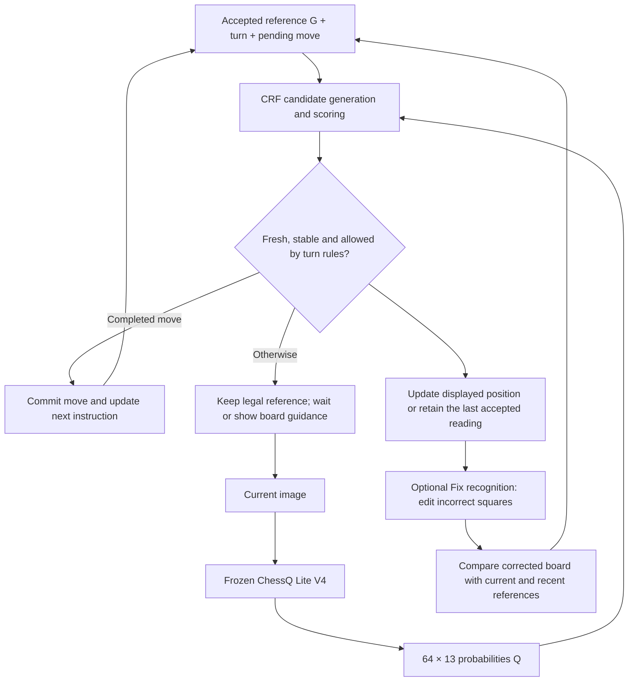

# CRF Accuracy Improvement — Experiment Log

Last updated: 2026-10-11 · Branch: `accuracy-improvement`

**Evaluation status: real continuous-video performance has not been measured.** There is currently no measured end-to-end accuracy for the original application, the 25-weight CRF, or the 250-weight CRF on the same labeled camera recordings. No deployment accuracy improvement or parameter-count winner is established here.

**Latest offline evidence — E14:** Six neural postprocessors compared with the two CRFs on the same 176-photo protocol. Small point-estimate gains, with no statistically established overall winner. See [Evaluation](crf-real-photo-synthetic-previous-evaluation.md) for accuracy and latency.

**Historical evaluation:** The [annotated archive — evaluation scope issues](crf-experiment-log-2026-10-11-evaluation-issues.md) preserves the complete pre-cleanup log. E11 removed its synthetic/static-photo scores, epoch metric tables, and screening conclusions from this active record. Those offline diagnostics did not establish a CRF-disabled application baseline or continuous tracking accuracy. E12 records a separately specified photo protocol; its scores must not be compared directly with the archived scores as a before/after improvement.

**Implementation status:** Settings offers eight postprocessors behind the unchanged ChessQ Lite V4 recognizer. The two-layer changed-square MLP is the default; both CRFs remain available. See E14.

The design and implementation history below remain available. Dataset provenance and preparation details are in the [dataset build record](crf-data.md). Bulk data and run artifacts under `data/crf/` are local and Git-ignored.

## Current experiment status

### Where the current data came from

| Data stream | Source | Current artifact and intended use |
| --- | --- | --- |
| Main synthetic dataset | Official Lichess standard-game PGNs: [January 2013](https://database.lichess.org/standard/lichess_db_standard_rated_2013-01.pgn.zst) and [February 2013](https://database.lichess.org/standard/lichess_db_standard_rated_2013-02.pgn.zst), CC0; first 6,000 games from each archive | `data/crf/synthetic-v1/`: 20,000 unique transitions, expanded into 200,000 observations for training/validation/testing |
| Auxiliary real photographs | [Felix Fabricius's Robot chess commentator dataset](https://huggingface.co/datasets/felixfabricius/robot-chess-commentator-squares), CC-BY-4.0; pinned revision `d71ba52761e497b18bbe5743efcbafb0d1f21091` | `data/crf/real/robot-v1/`: 371 source photos, yielding 176 current-photo/annotated-previous-state examples with measured frozen-model probabilities |
| Local partial labels | This application's existing human correction archives, paired with the original image and model output | `data/crf/real/local-corrections/`: 26 frames with 27 explicitly labeled squares, for calibration only |

The **200,000 main observations are generated probability arrays, not generated images or measured model outputs**. Their board labels come from replayed PGNs and explicitly marked derived transitions. The public photographs and local corrections are separate auxiliary datasets and are not mixed into that count. Source checksums and acquisition metadata are recorded in the PGN source manifest (`data/crf/raw/sources.json`, local only) and photo source manifest (`data/crf/real/robot-v1/source.json`, local only).

The synthetic split contains **16,000 / 2,000 / 2,000 base transitions** for train / validation / test, each expanded into ten correlated probability profiles. The 160,000 training observations are not 160,000 independent photographed moves. The Felix dataset's `train` / `validation` / `test` names are its source-photo split labels; neither CRF was fitted on those photos.

### Operations completed

1. **Acquire and verify sources.** Downloaded both complete PGN archives and the pinned public board-image files; checked published SHA-256 hashes. Verified local image/output pairing before accepting correction labels.
2. **Replay and filter chess records.** Parsed 12,000 games with `python-chess`, rejected invalid/short records, and deduplicated games. Replayed 799,101 legal plies from 11,943 unique valid games; sampled ordinary transitions, retained special moves, and generated separately tagged legal promotion alternatives.
3. **Deduplicate and partition before probability augmentation.** Removed 14,779 duplicate transitions. Assigned source games to train/validation/test and excluded 4,658 transitions with placements shared across splits. All variants of a transition stay together.
4. **Select and supplement 20,000 transitions.** Retained 18,000 legal moves (16,022 recorded moves and 1,978 generated promotion alternatives), then generated 1,500 unchanged examples and 500 identity-preserving illegal relocations. Checked derived placements for split overlap too.
5. **Generate and validate observations.** Produced ten `64 × 13` probability variants per transition, keeping previous-state and target labels intact. Profiles cover clean observations, type/occupancy/color confusion, neighboring-square errors, confident mistakes, and regional uncertainty. Saved 40 shards: 160,000 train / 20,000 validation / 20,000 test observations, with metadata, seeds, checksums, and the exact generator snapshot.
6. **Prepare auxiliary real data.** Filtered public annotations, deduplicated transitions, removed cross-split and synthetic overlaps, normalized image orientation, and ran frozen ChessQ Lite inference on the 176 retained examples. For local corrections, retained only explicitly labeled squares and masked all other cells. These are still-photo/partial-label records, not verified continuous-video events.

### Current status

| Work item | Status | Evidence / remaining work |
| --- | --- | --- |
| Source acquisition and data preparation | Complete | E01–E04; original datasets and split assignments retained |
| v1 training | Complete | 25-weight checkpoint and run artifacts retained; E06 |
| v2 training | Complete | Separate 250-weight checkpoint and run artifacts retained; E10 |
| Public still photos with sampled synthetic previous states | Evaluated offline | 176 photos; one-state and all-correct results with 5/10 different predecessors for raw argmax, fixed scoring, v1 and v2; E12 |
| Felix dataset test split | Now evaluated / exposed | 55 photos from 10 setups included in E12; no longer an untouched test set for future tuning |
| Synthetic test split | Remains unscored in the recorded experiments | 20,000 observations; E12 evaluates Felix dataset photos |
| Application integration | Eight selectable postprocessors | E14; video comparison and promotion issue remain outstanding |
| Original pipeline on labeled continuous video | Not measured | Baseline accuracy, wrong commits, missed moves, and latency remain pending |
| v1/v2 on the same labeled continuous video | Not measured | Comparison must preserve each pipeline's predicted-state feedback and temporal logic |
| Earlier evaluation protocol | Archived with scope warning | Historical scores remain in the archive; E12 results have their own explicit protocol |

## Design — CRF baseline and shared application flow

The original proposal introduced a frozen recognizer plus a small CRF postprocessor. E07 replaced mandatory per-observation confirmation with automatic play and optional state correction. The equations, flow and terminology below now reflect that revision; the earlier confirmation policy and original evaluation decisions are preserved in the annotated archive.

### Objective and hypothesis

Improve board recognition accuracy and response time without changing ChessQ Lite V4's weights. A piece-type error in one image should not override the accepted previous board when the implied transition is implausible. A real illegal move should remain detectable rather than being forced into a legal move. The user corrects the recognized state through **Fix recognition**, without labeling the cause of an error.

The working hypothesis is that a small postprocessor conditioned on a previous board can correct some visual errors using piece identity, movement, and unchanged-square evidence. The learned scorer processes one observation at a time; the application controller supplies temporal stability checks. Reliability on this camera and chess set remains to be measured.

### Model and state

Use a **single-step conditional log-linear model**, described here as a CRF postprocessor with its previous state fixed. Candidate scoring is how this model performs inference; it is not an additional neural model after the CRF. The baseline below uses v1's 25 stored learned coefficients. E10 adds v2 with 250 learned residual coefficients; E14 adds six neural residual scorers. All eight are selectable in the application and keep the image recognizer frozen.

| Symbol | Meaning |
| --- | --- |
| `G` | Current accepted legal reference: 64 piece labels plus side to move, castling rights, and effective en passant information; retain game history separately |
| `Q` | `64 × 13` class probabilities: measured frozen-recognizer outputs in live/photo inference; generated arrays during synthetic training |
| `B` | Candidate current physical board, represented by 64 labels |
| `B*` | Ground-truth target during training, or the edited physical board when the user applies a correction |
| `C(G)` | Candidate boards reachable from `G` by supported operations |
| `m` | Pending computer move, if an instruction has been issued |

During live play, `G` can be provisionally accepted by the application rather than explicitly checked by the user. Not opening Fix recognition permits play to continue; it does not certify the board as human-labeled ground truth. Both CRFs were trained with a supplied, correct previous state. E12 constructs that state from the labeled target. Neither setting measures recovery from an already mistaken live reference.

Class order is `. P N B R Q K p n b r q k`; square order is a8 through h8, then a7 through h7, down to a1 through h1. The 64-label vector alone is insufficient to determine all legal transitions.

### Transition and scoring equations — v1

The supported model assumes an observation interval contains either no completed move, one completed legal move, or one supported physical mistake. Let `A(G)` contain those operations:

$$
\mathcal A(G)=\{\mathrm{unchanged}\}\cup\mathcal A_{\mathrm{legal}}(G)\cup\mathcal A_{\mathrm{mistake}}(G),
\qquad
\mathcal C(G)=\{T_{\mathrm{physical}}(G,a):a\in\mathcal A(G)\}.
$$

`T_physical` returns the resulting piece placement. Legal operations include captures, castling, en passant, and promotions. Supported mistakes preserve the moved piece's identity; v1 data cover a non-king piece relocated illegally to an empty square. An arbitrary pawn-to-bishop change away from promotion is not a supported transition. Multiple missed moves and intermediate hand/piece occlusions require rejection or resynchronization; v1 does not model them.

Score and normalize over candidates:

$$
s_\theta(G,Q,B)=\theta^\top f(G,Q,B),
\qquad
P_\theta(B\mid G,Q)=
\frac{\exp s_\theta(G,Q,B)}{\sum_{B'\in\mathcal C(G)}\exp s_\theta(G,Q,B')},
\qquad
\hat B=\underset{B\in\mathcal C(G)}{\arg\max}\;s_\theta(G,Q,B).
$$

The 25 v1 coefficients cover 13 class log-probability features, three empty/white/black log-probability features, one probability-fit feature, one argmax-agreement feature, and seven operation flags. One visual-fit feature is:

$$
f_{\mathrm{visual}}(Q,B)=\sum_{i=1}^{64}\log\bigl(\max(Q_{i,B_i},\epsilon)\bigr).
$$

These classifier probabilities are features, not a claim that the recognizer supplies a generative HMM emission model. The previous state is fixed for each inference call, so training uses pairs of successive states rather than requiring a long-sequence network. A first-order Markov assumption alone would not eliminate sequence inference if previous states were uncertain; the current implementation uses explicit correction and rollback to repair an erroneous accepted reference.

Train only the postprocessor by conditional negative log-likelihood, with optional L2 regularization:

$$
\mathcal L(\theta)=-\frac1N\sum_{n=1}^{N}\log P_\theta(B_n^*\mid G_n,Q_n)+\lambda\lVert\theta\rVert_2^2.
$$

Every training target must be present in its candidate set; this was audited before fitting. A high relative probability does not establish that any candidate is correct. The live adapter therefore also checks absolute visual fit, occupancy evidence and temporal stability. E07 records the current heuristic thresholds; real-video calibration remains outstanding. E12 evaluates the scorers' top-ranked boards without these acceptance gates or temporal votes. Legal / unchanged / illegal-operation labels and uncertainty are internal model or controller information, not review categories for the user.

### Automatic acceptance and correction



For ordinary play, let `E` mean that the fresh-evidence and stability checks passed. The automatic update is:

$$
G_{\mathrm{next}}=
\begin{cases}
\operatorname{ApplyLegal}(G,a) & E\ \land\ \text{player turn and }\hat B=T_{\mathrm{physical}}(G,a),\\
\operatorname{ApplyLegal}(G,m) & E\ \land\ \text{computer turn, }m\text{ issued and }\hat B=T_{\mathrm{physical}}(G,m),\\
G & \text{otherwise}.
\end{cases}
$$

Here `a` is a unique matching legal player move. While the engine is thinking, no observation can commit another move. Issuing an instruction resets the inference context: evidence gathered before it cannot supply the votes for accepting the computer move. Initial setup, promotion choices and saved-game recovery keep their existing dedicated handling.

Opening **Fix recognition** pauses automatic acceptance and freezes the displayed board. Applying edits supplies `B*`; there is no additional choice of error type. Reconciliation checks the current state first, then recent pre-move checkpoints from newest to oldest:

| Corrected board `B*` | Reference and instruction handling |
| --- | --- |
| Current accepted placement | Keep history and any pending computer instruction |
| Legal successor of the current reference | Process it through the current turn's rules; only the pending move can complete a computer turn |
| An earlier pre-move placement | Restore that checkpoint and undo subsequent inferred moves; discard engine work based on the mistaken state |
| Legal successor of an earlier checkpoint | Restore that checkpoint, then process the corrected move through its turn rules |
| No supported match | Keep the legal reference and show the corrected physical board for guidance |

Both player and computer turns use this comparison. If a stationary board was mistaken for a player move, correcting it to the previous placement removes that move and the computer reply it caused. If the player's move was real but the computer move was falsely detected, correction restores the board after the player's move and the original pending computer instruction. Neither case asks the user to identify who caused the error. A rolled-back engine job cannot later overwrite the corrected instruction.

Checkpoints retain turn, rights, history and pending instructions; piece placement alone cannot recover those fields. Current-state matches take priority, so repeated placements do not automatically trigger an undo. The current buffer holds eight plies and is cleared on reset/load or explicit Undo. Strict saved-position recovery and paused games do not use automatic correction rollback.

Turn constraints reduce opportunities for recognition to run ahead, but an incorrect recognized move can still be legal. Do not assume that a later illegal-board warning will always expose it. Physical testing should include a stationary board on each turn and correction after a false acceptance. Only explicitly edited squares are exported as human labels; automatic acceptance and absence of correction are not ground truth.

### Real-video evaluation — pending

A future video evaluation should identify the labeled camera recordings and compare the complete CRF-disabled pipeline with the CRF variants on the same inputs. Each pipeline must advance using its own predicted state and temporal logic; supplying a correct reference before every move measures a different task. Report wrong commits, missed moves, board/move accuracy, and time to acceptance with their denominators. Include stationary boards, legal moves, physical mistakes, occlusion, and recovery after a mistaken reference. E12 is a completed offline photo evaluation; these video measurements remain pending.

## Experiment entries

Entries record work and checks performed at the stated stage. Historical test-pass counts are not new test runs during this documentation update; the status table above reflects the latest evidence.

### E01 — Source acquisition and implementation · 2026-10-11

**Purpose:** Build a reproducible dataset programmatically, with attributable sources and leakage checks.

**Actions:** Implemented [synthetic acquisition/build/validation](../scripts/build_crf_dataset.py), [real-data preparation and frozen inference](../scripts/prepare_crf_real.py), [focused tests](../scripts/test_crf_dataset.py), and [real-data validation](../scripts/validate_crf_real.py). Downloaded the official Lichess January and February 2013 standard-game archives (CC0), verifying their published SHA-256 hashes. Pinned the public Robot chess commentator dataset revision and verified the downloaded board files' hashes. Paired local correction records with their exact captured images and model outputs.

**Decisions:** Use the small complete Lichess archives for economical acquisition, without treating their move frequencies as deployment frequencies. Keep generated examples distinguishable from recorded play. Exclude unverified sources and partially matched local records. Detailed source links, licenses, and exclusions are in the [build record](crf-data.md#sources-and-provenance).

### E02 — Tests and smoke build · 2026-10-11

**Purpose:** Verify labels, chess rules, perturbations, and splits before full generation.

**Actions and results:** Seven focused tests passed. Built and validated **1,000 transitions / 10,000 observations**, checking 640,000 probability rows. Targets replayed or passed physical-operation validation; duplicate inputs/transitions and cross-split game/placement overlaps were all zero.

**Decision:** Proceed to full generation. The smoke set is a build check and must not be merged into training. Evidence: smoke validation (`data/crf/smoke-v1/validation.json`, local only).

### E03 — Full synthetic dataset v1 · 2026-10-11

**Actions:** Read 12,000 PGN games and replayed 799,101 legal plies from 11,943 valid unique games. Removed 53 short/invalid games, 4 duplicate games, and 14,779 duplicate transitions. Removed a further 4,658 transitions sharing physical placements across splits, leaving 145,337 eligible transitions before final selection and augmentation.

**Results:**

| Item | Result |
| --- | ---: |
| Unique selected transitions | 20,000 |
| Legal / unchanged / illegal relocation | 18,000 / 1,500 / 500 |
| Recorded legal moves / generated legal promotion alternatives | 16,022 / 1,978 |
| Opening / middlegame / endgame | 4,339 / 9,149 / 6,512 |
| Synthetic probability observations | 200,000 in 40 shards |
| Train / validation / test observations | 160,000 / 20,000 / 20,000 |
| Probability rows validated | 12,800,000 |
| Duplicate inputs / duplicate transitions | 0 / 0 |
| Cross-split games / physical placements | 0 / 0 |

All targets passed replay or physical-operation checks. The manifest records **65.77 seconds for generation**, excluding acquisition, subsequent validation, and any model training. Ten profiles include clean observations, type confusion on 1/5/10 squares, occupancy/color errors, neighboring-square swaps, confident errors, regional uncertainty, and mixed errors. RNG seed: `20261011`.

**Decision at this stage:** Dataset v1 passed structural checks and was ready for candidate-coverage auditing and training, subsequently completed in E06/E10. Its noise mixture is a synthetic training/stress distribution; it cannot establish acceptance thresholds or production accuracy. Evidence: manifest (`data/crf/synthetic-v1/manifest.json`, local only), validation (`data/crf/synthetic-v1/validation.json`, local only), and the exact generator snapshot (`data/crf/synthetic-v1/generator-source.py`, local only).

### E04 — Real photographs, local corrections, and inference · 2026-10-11

**Actions:** Retained 371 source photographs from Felix Fabricius's [Robot chess commentator: square dataset](https://huggingface.co/datasets/felixfabricius/robot-chess-commentator-squares). From 216 initially valid photographed legal transitions, excluded 28 cross-split overlaps, 10 duplicates, and 2 overlaps with synthetic endpoint placements, leaving **176**. Retained the dataset's setup-based splits: 54 train / 67 validation / 55 test. Rotated images using the dataset's orientation metadata; no label-based search for the best rotation.

Matched **26 local frames with 27 explicitly labeled squares**. All other squares remain masked, including unchanged labels copied from model output. One incomplete paired record was excluded. These corrections are calibration-only, not whole-board test labels.

**Issue and resolution:** The first frozen-model inference smoke attempt failed on MPS because bicubic antialiased interpolation was unsupported. Enabled `PYTORCH_ENABLE_MPS_FALLBACK=1`, reran the five-image smoke check successfully, and completed inference for all 176 retained public transitions. Model weights stayed frozen. The inference manifest records the checkpoint hash, Torch 2.6.0, MPS device, and CPU fallback setting.

**Evaluation scope:** Each retained item pairs a current photo with the Felix dataset's annotated previous FEN. The old scorer was given that reference as correct for every item; it did not recognize an earlier photo and propagate its prediction. Scores from that protocol remain in the annotated archive. E12 reuses the current-photo probabilities but replaces the annotated reference with sampled synthetic predecessors. Neither protocol measures recognition of a real earlier frame or continuous-video accuracy.

**Data validation:** Zero audited duplicate transitions, cross-split placements/setups, or synthetic–real endpoint overlaps. These are structural consistency checks, not independent visual relabeling or performance measurements. Local evidence: `data/crf/real/validation.json`.

### E05 — Consolidate experiment record · 2026-10-11

Originally consolidated the proposal, equations, implementation flow, and experiment history into this log. The full pre-cleanup document is retained in the annotated archive. The dataset build record remains the preparation reference.

### E06 — v1 training record; evaluation archived · 2026-10-11

**Training:** Trained the 25-weight conditional log-linear model on the existing 160,000 synthetic training observations, with 20,000 synthetic validation observations and 20,000 reserved test observations. The image recognizer remained frozen. CPU Adam used 12 epochs, initial learning rate 0.03 reduced by 0.3 after epochs 6 and 9, L2 coefficient 0.001, seed `20261011`, and batches of 32 transitions with all ten noise profiles. Synthetic validation NLL selected the saved checkpoint at **epoch 6 of 12**; this was a training diagnostic, not a camera-accuracy measurement. The synthetic test split was not scored.

**Implementation:** [Conditional model](../scripts/crf_postprocessor.py), [trainer](../scripts/train_crf.py), and [model tests](../scripts/test_crf_postprocessor.py). Candidate generation includes supported legal moves, unchanged boards, and supported illegal relocations without target-dependent insertion. The fixed scorer shares these candidate constraints and the given previous state; it is not the original application's CRF-disabled video pipeline.

**Engineering checks:** Twelve focused tests passed during the original run. The candidate loader was corrected after an interrupted cache-preparation attempt; the completed training run and its source snapshots remain in `data/crf/runs/crf-v1-run2/`.

**Artifacts retained:** [crf-postprocessor-v1.json](../research/models/crf-postprocessor-v1.json), SHA-256 `5b5b265f6399e6c600202cae5d8e165fd6bd9db2e3cf31e5c194229aaee827db`. Configuration, epoch history, raw offline reports, and saved weights remain in the original run directory. Their numerical evaluation and historical screening decisions are available only in the annotated archive and local artifacts, not as current real-video results.

### E07 — Live integration and correction-only workflow · 2026-10-11

**Authorization and scope:** After E06 stopped, the user explicitly requested application integration on the existing branch and will test it personally. The user then clarified that ordinary recognition must not require approval or manual labels such as legal / unchanged / incomplete / physical mistake. A stable observation is provisionally accepted subject to the turn rules unless the user opens **Fix recognition**. This superseded the initial mandatory-confirmation policy. The historical offline screening is preserved in the annotated archive; this entry records implementation rather than video performance.

**Runtime:** Packaged the unchanged 25-weight checkpoint at `research/models/crf-postprocessor-v1.json` (SHA-256 `5b5b265f6399e6c600202cae5d8e165fd6bd9db2e3cf31e5c194229aaee827db`). The live adapter calls the same candidate generator and numerical score as training; ChessQ Lite V4's weights remain frozen. The checkpoint's `review_required` / `automatic_commit: false` fields preserve its original training artifact metadata; the explicitly authorized trial's acceptance policy lives in the game controller, not those fields.

The adapter reads the original 64 × 13 probabilities, conditions candidates on edited squares, and screens proposals using relative probability ≥ 0.60, score gap ≥ 0.7 where multiple candidates remain, mean log visual fit ≥ log(0.25), no strong occupancy contradiction, and changed-square occupancy/color support ≥ 0.55. It requires three distinct supporting camera readings spanning ≥ 0.45 seconds in a four-reading window, with two consecutive agreeing readings. Distinct readings are not statistically independent observations. These heuristics have not been calibrated on in-domain video; the span is a minimum stability interval, not measured end-to-end latency. Missing/invalid probabilities or a missing checkpoint hold the live CRF path.

**Turn protocol:** An unchanged board retains the reference and turn. A stable player move passes through the existing chess-rule controller. While the engine is thinking, observations cannot commit another move. Once the engine emits its instruction, fresh consensus is required and only that pending move's complete position can commit. Unsupported/incomplete or ambiguous evidence holds; an observed illegal move can produce existing board guidance but cannot enter the legal move history. These are internal decisions, with no classification buttons. The application cannot guarantee that every mistaken recognition will later produce an illegal position; real-camera false-commit measurement remains outstanding.

**Correction implementation:** The [current design](#automatic-acceptance-and-correction) defines the shared current/previous-state comparison for both turns. The editor uses the displayed recognized board while retaining raw input separately. The controller keeps eight pre-commit checkpoints with rule metadata, move history, pawn proxies and pending instructions. It restores a matching checkpoint before processing the corrected board and invalidates any obsolete engine job. This supports immediate recognition recovery within the current session; it does not reconstruct arbitrary old saved-game history.

The editor pauses automatic acceptance while open. Its lease is renewed by the existing two-second page heartbeat and expires after 20 seconds without renewal, so a crashed browser cannot pause the game forever. Apply or Cancel releases it and resets temporal votes. Drafts survive a failed request and can reopen against the same frozen evidence; a changed game position invalidates them. An arriving engine recommendation alone does not invalidate the editor. Promotion choices, pawn substitutes, initial setup and strict saved-game restoration keep their existing dedicated handling.

**Evidence and verification:** Raw probabilities, labels and the matched image are not overwritten by CRF output. Existing correction archives retain the frozen displayed board, raw input, explicit edits, resulting game snapshot and CRF decision metadata. Only explicitly edited squares become local training annotations. Automated checks cover no-op and wrong-move recovery on both turns, no progression while thinking, exact pending-move enforcement, fresh votes after an instruction, stale engine replies, correction leases/retries, evidence fidelity, occlusion/invalid/duplicate/stale frames, orientation, castling, en passant, promotion and saved-game recovery. **Results:** all 166 Python tests and all seven UI test scripts passed. A real-server startup/HTTP smoke check passed with the packaged checkpoint and correction-only UI; it did not start the camera and the smoke server was stopped afterward. See the test commands below; these verify behavior, not camera accuracy.

```bash
research/edgetam-env/bin/python -m unittest discover -s validation -p 'test_*.py'
for test in validation/test_ui_*.cjs; do node "$test" || exit; done
./start.sh
```

Quit any already-running Camera Chess instance before launching the updated application. The CRF is enabled by default in this branch. For a direct-server baseline comparison, `CHESS_CRF=0 research/edgetam-env/bin/python validation/lite_live_server.py` selects the previous recognition path. Do not run two servers on port 8769.

**Status at this stage:** Implementation complete and ready for the user's physical-board test; E09 subsequently records initial feedback. No re-training or held-out CRF test scoring occurred during E07. Representative video accuracy, false-commit rate and end-to-end latency remain unmeasured.

### E08 — Reconcile the experiment document with the implemented flow · 2026-10-11

Revised the main design section, state definitions, update equation and flowchart to describe automatic acceptance with optional state correction. Removed the obsolete mandatory-review diagram and duplicated correction flow. Documented current-state-first reconciliation, rollback on either turn, the turn protocol that prevents advancement while thinking, and the fact that lack of correction is not a human label. The dataset record now distinguishes internal operation labels from user annotations.

This entry changed documentation only. Dataset counts and E07's implementation checks are retained; historical numerical evaluation is now in the annotated archive. No new test run or camera measurement was reported at this stage; subsequent trial feedback appears in E09.

### E09 — Initial physical-board feedback and commit preparation · 2026-10-11

**Manual feedback:** Recognition worked reasonably well in an initial trial. A computer pawn promotion to a knight left the Confirm button unavailable. This is qualitative feedback, not an accuracy measurement. The current README still lists this as unresolved; E12 does not test the promotion UI or establish a fix.

**Next validation:** Reproduce computer underpromotion with both a replacement piece and a pawn substitute, then continue physical-board recognition and correction tests. Preserve the failing case locally when available; no private camera image or game record is included in the repository.

**Documentation and checks:** Updated all three README versions with the ChessQ Lite V4 → separately trained CRF pipeline, experiment links and the known promotion issue. Re-ran 166 application Python tests, 12 CRF/data tests and seven UI test scripts; all passed. These automated checks did not reproduce or resolve the reported physical-board issue. Local dataset and run-artifact references are paths rather than links to files that will not be published.

**Repository record:** The application integration, data/training scripts, tests, documentation and v1 checkpoint were subsequently recorded in local commit `56850cf` (`Add trained CRF board recognition and correction recovery`). Downloaded/generated datasets, raw camera frames, saved games, correction archives, logs and local environments remain excluded. Commit `a0efb46` later removed provisional CRF parameter details from the READMEs. This documentation update does not create a commit or establish any push/merge status.

### E10 — v2-250 training record; evaluation archived · 2026-10-11

**Scope:** The additional experiment was saved separately as `crf-v2-250-run1`, model ID `crf-v2-250`, checkpoint schema 2. The original v1 checkpoint and run records were preserved. The application continues to use v1; no model replacement was made by this training experiment.

**Model fixed before the full run:** Implemented [v2 scoring](../scripts/crf_postprocessor_v2.py) and a [separate trainer](../scripts/train_crf_v2.py). Candidate generation, class/square ordering, and supported transitions are exactly those of E06. The scorer has a fixed sum-log-probability term plus 250 learned residual coefficients:

| Feature family | Parameterization | Weights |
| --- | --- | ---: |
| Cross-class visual evidence | 12 non-reference output classes × 13 input log probabilities | 156 |
| White/black occupancy evidence | 12 output classes × 2 group log probabilities | 24 |
| Class-specific probability and confidence calibration | 13 classes × (probability, normalized entropy × class log probability, top-two margin × class log probability) | 39 |
| Agreement with the recognizer's top class | One coefficient per candidate class | 13 |
| Confidence-dependent class preference | Maximum input probability × 12 non-reference output classes | 12 |
| Operation preference | Legal, illegal, capture, castling, en passant, promotion; unchanged is the reference | 6 |
| **Total** | | **250** |

The empty class fixes the common-score freedom in the confusion/group matrices and confidence-dependent class preference. Empty-group evidence is already an input to the confusion matrix, so it is not duplicated. All weights are shared across squares. There are no position-specific or video-history features: the current synthetic probability data do not supply measured camera-location errors or continuous-video histories. This remains a single-step conditional log-linear model, not a new image recognizer. Numerical tests verify that any v1 scorer can be embedded in this family without changing its conditional distribution; that embedding is not used to initialize training.

**Training record:** Used the same 160,000 synthetic training observations and 20,000 synthetic validation observations, the original split assignments, and all ten noise profiles. As in E06: CPU Adam, seed `20261011`, 12 epochs, 32 transitions per batch, learning rate 0.03 reduced by 0.3 after epochs 6 and 9, and L2 coefficient 0.001. Initialization reproduces fixed sum-log-probability scoring. Synthetic validation NLL selected **epoch 8 of 12**. v2 regularizes residual coordinates, so an equal L2 coefficient does not imply the same prior over scoring functions as v1. This compares two trained feature/regularization configurations, not parameter count in isolation, and does not identify an optimal CRF size.

**Engineering checks:** All 16 focused CRF/data tests passed, including checks of v1 score embedding, NumPy/PyTorch score and gradient agreement, candidate padding, and cross-version checkpoint rejection. The separate smoke run completed before full training. All 13 protected v1 source/checkpoint/run-JSON artifacts retained their hashes. No held-out CRF test scoring or application integration was performed during E10. E12 later evaluated the Felix dataset test split; the synthetic test split remains unscored.

**Artifacts retained:** [crf-postprocessor-v2-250.json](../research/models/crf-postprocessor-v2-250.json), SHA-256 `e441f01ebc1c0d43907c676a751d5e8a38f3fc89fd9d2c23e22603509d4d804e`. Full local run: `data/crf/runs/crf-v2-250-run1/`; console output: `data/crf/runs/crf-v2-250-run1.log`; smoke run: `data/crf/runs/crf-v2-250-smoke1/`. Numerical comparison tables, epoch metric rows, and conclusions from the former protocol were moved out of the active log into the annotated archive. No claim about which variant performs better on real video is retained.

### E11 — Archive the former evaluation and reset the active record · 2026-10-11

At the user's request, saved the complete pre-cleanup log under a separate name with an evaluation-scope warning, then retained this file's original name and removed the former synthetic/static-photo accuracy tables, epoch metric tables, screening claims, and associated performance conclusions. Model definitions, training provenance, data preparation, and implementation records remain. The original model/data/run files were not modified. Real-video results are pending work under a separately established evaluation protocol.

### E12 — Felix dataset photo comparison with sampled synthetic previous states · 2026-10-11

Evaluated raw predictions, fixed candidate scoring, and v1/v2 CRFs on 176 photos with nested 1/5/10 synthetic predecessors. These predecessors are constructed from the correct target, so the results measure conditional scoring rather than continuous-video accuracy. See the [Evaluation report](crf-real-photo-synthetic-previous-evaluation.md) and [protocol/audit record](crf-photo-evaluation-audit.md) for results, reproduction and hashes.

## E13 — User playtest feedback and proposed live-data collection (2026-10-11)

The user reported generally correct accepted positions with little need for correction, but delayed recognition in sparse endgames, sometimes resolved by tilting the board. This is qualitative feedback; the cause remains unverified. A [collection and labeling plan](live-data-collection-plan.md) records the proposed evidence, review workflow and acceptance checks. Collection implementation is recorded in E15; physical-camera pilot measurements and training remain pending.

## E14 — Neural postprocessors and model selection (2026-10-11)

Trained six postprocessors on the existing synthetic train/validation split, keeping ChessQ Lite V4 and the v1 baseline frozen. All 72 epochs completed. Evaluated every model on the same 176 photos and nested predecessor conditions. Two-layer changed-square MLP scored 128/176 (72.73%) with one predecessor versus v1's 125/176 (71.02%); Attention led the ten-predecessor all-correct count at 82/172 versus 80/172. Paired confidence intervals include zero, so these small gains do not establish a reliable winner or improved video accuracy. See [full results and artifacts](crf-real-photo-synthetic-previous-evaluation.md#neural-postprocessor-comparison--2026-10-11).

A simple one-board timing comparison measured about 8–10 ms for candidate generation and scoring across all eight models; see the [latency table and measurement scope](crf-real-photo-synthetic-previous-evaluation.md#single-board-latency-comparison).

Settings → **Recognition Model** now selects one of two CRFs or six neural postprocessors, always combined with ChessQ Lite V4. Changes apply immediately and are saved locally. The default is the two-layer changed-square MLP, based on the highest one-predecessor photo point estimate, not a validated live-video advantage. Switching clears prior consensus before accepting fresh observations.

## E15 — Optional local evidence recording (2026-10-11)

Implemented the conservative collection portion of E13: exact producer-side images/probabilities, separately linked pre/post controller decisions, selected checkpoint and actual scorer, color/turn/physical-proxy context, failed/held observations, sampled camera context and correction events. Settings defaults to local recording and includes a persistent opt-out plus Open Log Folder. Date/time filenames include an offset and short suffix. Bounded asynchronous writers share a conservative 20 GiB budget, stop on write failures and never evict existing evidence. Disabling also makes correction drafts RAM-only.

Predictions remain unverified. Offline checksum/pairing audit, image gallery, explicit per-image labels and guarded export are described in [local improvement data](local-improvement-data.md). Partial edits do not certify whole boards. No automatic backward labeling, training, upload or accuracy claim. Real camera/storage overhead and annotation quality still need the planned pilot; sampled context is not uninterrupted video.
